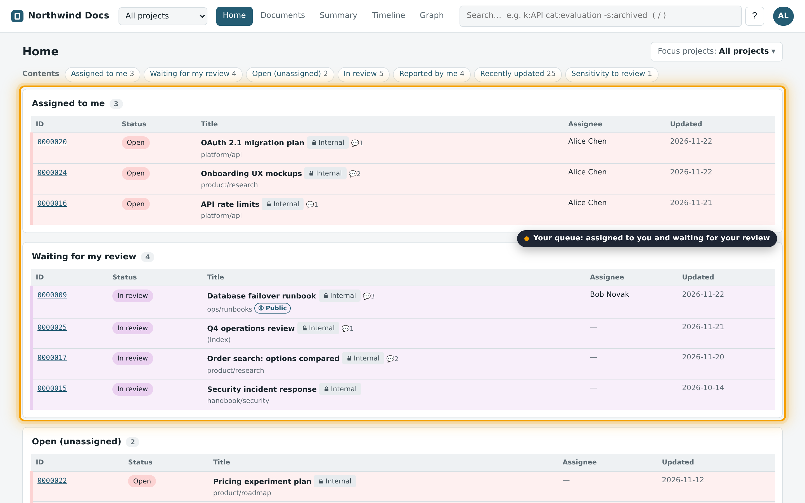
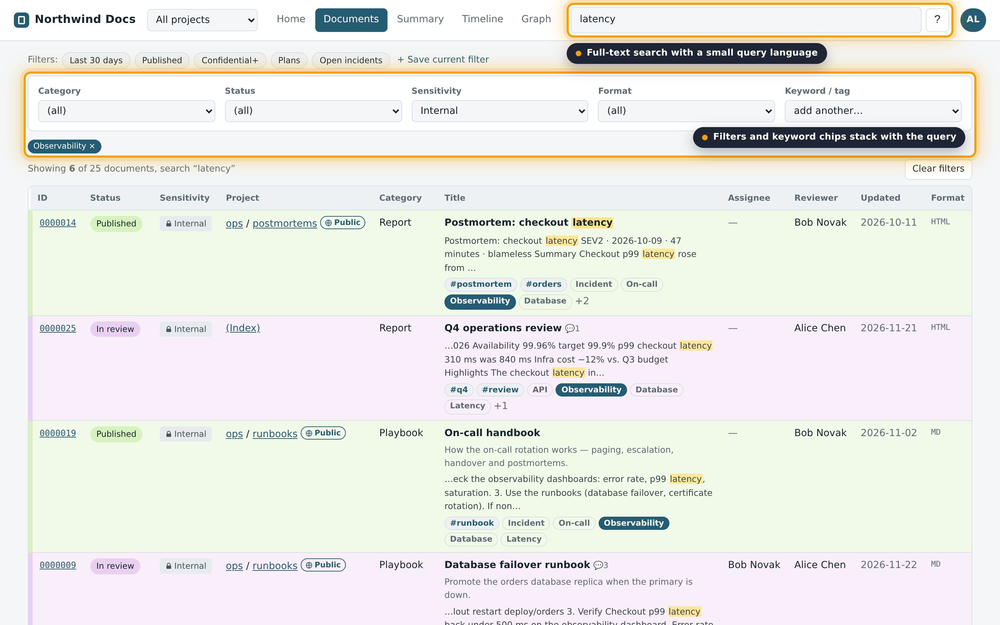
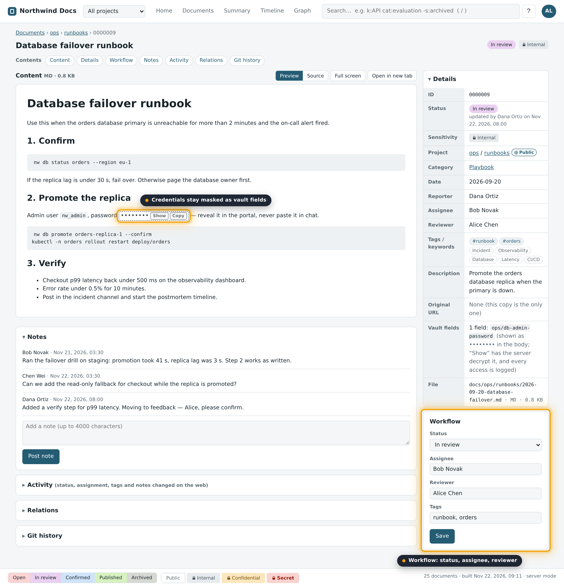
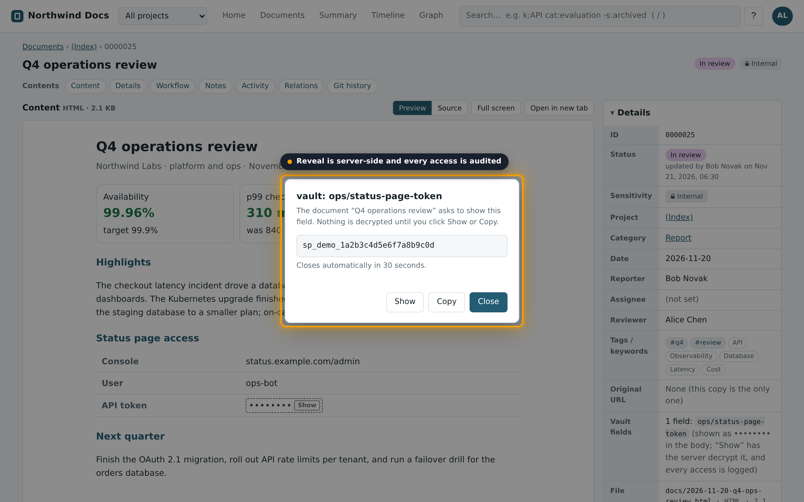
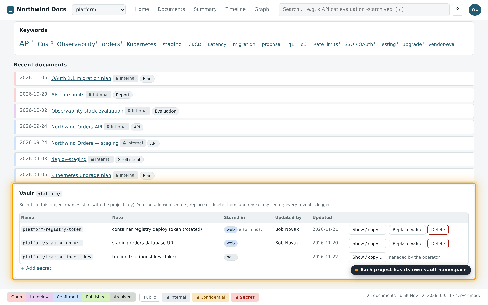
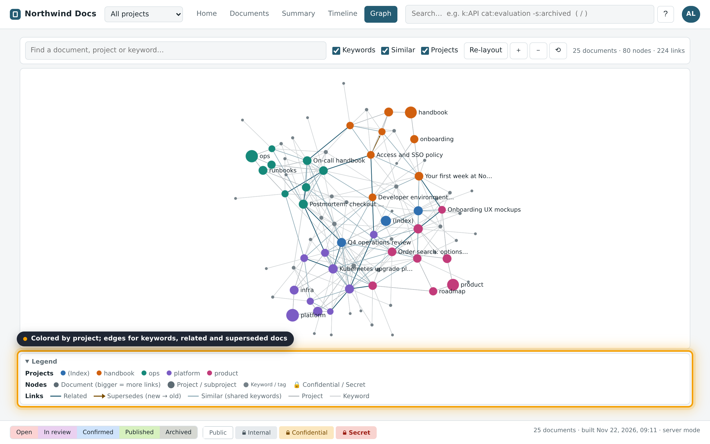
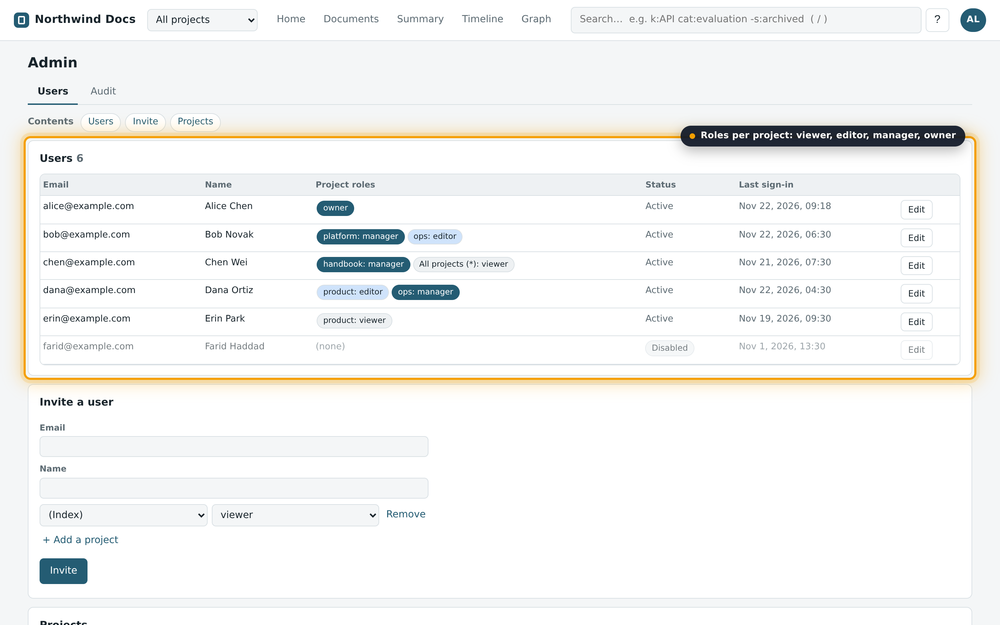

# gitdocs-portal

**English** · [繁體中文](README.zh-TW.md)

[](https://github.com/osisdie/gitdocs-portal/actions/workflows/ci.yml)
[](LICENSE)
[](package.json)
[](package.json)
[](#deploying)
[](#interface-language)

A MantisBT-style document portal where **git is the database**. Drop HTML / Markdown / shell / Postman files into
`docs/`, run one build, and get a searchable, filterable portal with projects, keywords, sensitivity levels,
per-file git history — and a **vault** that keeps credentials out of git while the documents around them stay
versioned. The output is a static site; the reference deployment is Cloudflare Pages behind Cloudflare Access.

## Contents

- [Features](#features)
- [Screenshots](#screenshots)
- [Quick start](#quick-start)
- [Engine repo vs. content repo](#engine-repo-vs-content-repo)
- [Vault: masked credentials](#vault-masked-credentials)
- [Sensitivity levels](#sensitivity-levels)
- [Catalog CLI and search syntax](#catalog-cli-and-search-syntax)
- [Interface language](#interface-language)
- [Deploying](#deploying)
- [Server mode (multi-user)](#server-mode-multi-user)
  - [Public projects](#public-projects)
  - [Confidential documents](#confidential-documents)
- [External content sources](#external-content-sources)
- [Contributing](#contributing)

## Features

- **Projects / subprojects** from folders (`docs/<project>/<subproject>/…`), with a project switcher like Mantis.
- **Inferred metadata**: id, category, status, date, keywords (from a regex dictionary), sensitivity — all
  editable through a CLI and stored in a single `docs/catalog.json`.
- **Full-text search** with a small query language (`p:`, `cat:`, `s:`, `sens>=`, `k:`, `date>=`, `-exclude`, `"phrase"`),
  shared by the browser and the CLI.
- **Views**: list with sortable columns and saved filters, summary matrices, timeline, project pages, document
  pages with related / superseded / similar documents and git history.
- **Sensitivity**: `公開 / 內部 / 機密 / 極機密` (public / internal / confidential / secret); higher levels are
  kept out of the search index or out of the deployment entirely.
- **Vault**: `{{vault:name}}` placeholders render as `••••••••` with reveal / copy buttons; values are encrypted
  in `vault/vault.json` and decrypted only in the browser after entering a passphrase.
- **Postman**: environment and collection files are first-class documents; `npm run vault -- postman <file>`
  moves secret variables into the vault.
- **Workflow** (Mantis-style): `待處理 → 待確認 → 已確認 → 已發布 / 封存` (new → feedback → confirmed → published /
  archived), with `reporter` / `assignee` / `reviewer` per document.
- **Knowledge graph** (Sigma.js): documents, projects and shared keywords as a force-directed graph — search,
  layer toggles, zoom and rotate (↺ ↻, Shift+drag, two fingers on touch).
- **Interface**: English / 繁體中文, light / dark / system theme, responsive down to phone width.
- **Server mode** (optional): Pages Functions + D1 behind Cloudflare Access — per-project roles, web edits and notes,
  a server-side vault with an audit log. See [Server mode](#server-mode-multi-user).
- No framework, no runtime dependencies. Node ≥ 20 for the build, Node ≥ 22 for `npm test`.

## Screenshots

**Home — what needs you, at a glance**



**Search and filter — full text, query language, keyword chips**



**Document page — the content first, metadata and workflow beside it**



**Vault reveal — role-checked, decrypted by the server, audited**



**Project vault — managers add, replace and reveal secrets per project**



**Knowledge graph — documents, projects and shared keywords**



**Admin — per-project roles and invitations**



All 15 screenshots (summary, timeline, dark theme, profile menu, admin projects, zh-TW, …): [assets/screenshots/](assets/screenshots/README.md).
Regenerate with `npm run screenshots` — demo content from `examples/`, a mocked server-mode API, headless Chromium via a
pinned `playwright-core`; no server is started. `-- --plain` writes a set without highlights.

## Quick start

```bash
git clone https://github.com/osisdie/gitdocs-portal.git && cd gitdocs-portal
npm run build      # builds the demo content in examples/ into dist/
npm run dev        # http://localhost:8788  — demo vault passphrase: correct horse battery staple
```

## Engine repo vs. content repo

This repository is the **engine** (portal UI + build + CLIs) with demo content in `examples/`. Real documents
live in a separate, usually private, **content repo** that vendors the engine:

```
content repo (private)                      gitdocs-portal (this repo, public)
├── docs/            ← your documents       ├── site/        portal UI
│   └── catalog.json ← metadata             ├── scripts/     build, doc CLI, vault CLI, engine sync
├── vault/vault.json ← encrypted secrets    ├── examples/    demo content
├── .engine-ref      ← pinned engine commit └── templates/   CI for content repos
└── site/ scripts/ … ← vendored, read-only
```

- `npm run engine:update [ref]` copies the engine paths listed in `scripts/engine-paths.txt` from upstream and
  pins the commit in `.engine-ref`.
- `npm run engine:check` fails when vendored engine files differ from that commit — run it in CI
  (`templates/gitlab-ci.yml`, `templates/github-actions.yml`) so engine changes always go upstream as a pull
  request first.
- Content settings live in `docs/catalog.json → site`: `title`, `projectRoot` (a folder under `docs/` whose
  children are projects) and `readmeIndex` (a Markdown table that supplies titles / descriptions / URLs).

Starting a content repo:

```bash
mkdir my-docs && cd my-docs && git init
mkdir docs && echo '{ "site": { "title": "My docs" } }' > docs/catalog.json
git fetch https://github.com/osisdie/gitdocs-portal.git main
git checkout FETCH_HEAD -- scripts/engine.sh && bash scripts/engine.sh update
cp .env.example .env   # fill in, never commit
```

## Vault: masked credentials

Documents often need credentials next to the prose that explains them. Committing them is wrong; deleting them
loses the document. The vault keeps both:

```bash
npm run vault -- init                         # once; passphrase from VAULT_PASSPHRASE or a prompt
npm run vault -- set aws/prod/access-key      # value from a hidden prompt or stdin, never argv
# in any document:  The key is {{vault:aws/prod/access-key}}
npm run vault -- scan                         # find plaintext credentials in docs/
npm run vault -- scan --fix                   # seal them and rewrite the files to {{vault:…}}
npm run vault -- postman docs/api/prod.postman_environment.json
npm run vault -- ls | get <name> | rm <name> | mv <old> <new> | rekey | check
```

- `vault/vault.json` holds only ciphertext and is committed, so secret changes are versioned too.
  Crypto: PBKDF2-SHA256 (600k iterations) → AES-256-GCM, with the secret's name as additional data so a
  ciphertext cannot be moved to another name. The same module (`site/vault-core.js`) runs in Node and the browser.
- The portal masks placeholders in Markdown / text / JSON previews: **顯示** reveals for 30 s, **複製** copies
  without showing. The derived key is a non-extractable `CryptoKey` kept in memory only (gone on reload or
  **鎖定 vault**).
- Documents are treated as untrusted: `/docs/*` is served with `Content-Security-Policy: sandbox` (opaque origin)
  and previewed in a sandboxed iframe, so a document's scripts can never reach the portal, the key or the vault.
  HTML documents get a tiny inlined shim that masks fields and asks the portal (via `postMessage`) to show a value
  in the portal's own dialog — the plaintext never enters the document.
- Share builds (`--max-sensitivity=…`) and `--no-vault` leave the vault out: fields stay masked for everyone.
- The passphrase is the whole security of the deployed ciphertext — use a long one, and keep the site behind
  authentication anyway.

## Sensitivity levels

| Level | Detected when | Build effect |
|---|---|---|
| 公開 public | manual only | like internal |
| 內部 internal | default | deployed, body indexed |
| 機密 confidential | personal / company identifiers: e-mail, phone, registry / VAT / IBAN / national id, street address | deployed, body **not** indexed, preview behind a click |
| 極機密 secret | plaintext credentials (`api_key=`, `sk-…`, `AKIA…`, private keys, GitHub / GitLab / Slack / Google tokens) | **not deployed**; metadata only |

Detection only ever raises a level. Moving credentials into the vault (`vault scan --fix`) is the way to bring
a document back down: `npm run doc -- set <id> sensitivity=內部`.

## Catalog CLI and search syntax

```bash
npm run doc -- ls 'k:API cat:評估 -s:已發布'
npm run doc -- show 14
npm run doc -- set 12 status=待確認 category=稽核
npm run doc -- assign 12 writer@example.com        # assignee; '-' clears
npm run doc -- review 12 lead@example.com          # reviewer; '-' clears
npm run doc -- tag 14 +vendor -draft
npm run doc -- relate 9 11 13
npm run doc -- supersede 14 6 --archive
npm run doc -- project handbook/onboarding 'desc=First-week material'
npm run doc -- kw add Stripe stripe '金流'
npm run doc -- filter add 'This week' 'after:-7d'
```

Search: `api 成本` (AND) · `"release notes"` · `-封存` · `p:handbook/onboarding` · `cat:評估` · `s:已發布` ·
`sens>=機密` · `k:API` · `type:json` · `id:14` · `date:2026-11` · `after:-30d` · `before:2026-11-20`.

Status, sensitivity and category values can also be written in English (the slug or the English label):
`s:open|in-review|confirmed|published|archived`, `sens:public|internal|confidential|secret`, `sens>=confidential`,
`cat:plan|evaluation|comparison|audit|design-ux|form|api|playbook|script-copy|shell-script|index|report`.
`s:published sens>=confidential` matches exactly what `s:已發布 sens>=機密` matches.

## Interface language

The portal UI is in **English** by default; **繁體中文** (zh-TW) is built in.

- **Switch:** profile menu (top right) → *Language*. The page re-renders in place (no reload). The choice is saved
  per user (server mode: `prefs.lang`; static mode: `localStorage` key `gitdocs:lang`).
- **Link to a language:** add `?lang=zh-TW` (or `?lang=en`) to the URL, e.g. `https://docs.example.com/?lang=zh-TW#/list`.
  It applies only when the viewer has not picked a language in the menu, and it is not saved. Useful for screenshots
  and shared links.
- **Data stays as stored.** Statuses, sensitivity levels, default categories and the index project are stored in
  Chinese (`待處理`, `機密`, `評估`, `（索引）`, …) in `catalog.json` and D1; the UI only *displays* them through label
  maps (Open, Confidential, Evaluation, (Index), …). Custom values you add are shown as written.
- **Add a locale:** copy `site/i18n/en.js` to `site/i18n/<tag>.js` and translate every value (keep the keys and the
  `{placeholders}`; plural messages are `{ one, other }` objects chosen by `Intl.PluralRules`). Then in
  `site/i18n.js` import it, add it to `CATALOGS` and `LANGS`, and teach `normLang()` the tag; add the file to
  `SHELL_FILES` in `functions/_lib/gate.js` (the server's allowlist; a test fails
  until it matches `site/`). Labels of stored values are the `status.*`, `sens.*`, `cat.*` and `project.*` keys.
  `site/vault-frame.js` (inlined into sandboxed HTML docs) carries its few strings inline and follows the document's
  own `<html lang>`.

## Deploying

`npm run deploy` builds and uploads `dist/` with Wrangler (direct upload, so `極機密` files never reach a
third-party build). Needs `CLOUDFLARE_API_TOKEN`, `CLOUDFLARE_ACCOUNT_ID`, `CF_PAGES_PROJECT` in `.env`.

Protect the site with Cloudflare Access (or any auth proxy). Include `*.<project>.pages.dev` in the Access
application: every deployment also gets a permanent preview URL.

## Server mode (multi-user)

Static mode is one audience behind one auth proxy. Server mode adds people: Cloudflare Pages Functions
(`functions/`) and a D1 database (`migrations/`) behind Cloudflare Access give per-project roles, workflow edits and
notes from the browser, and a vault that the server decrypts for editors only, with an audit trail. The full contract
is [DESIGN.md](DESIGN.md). Without a D1 binding the functions pass every request through, so static deployments of
the same engine behave exactly as before; if `ACCESS_AUD`, `TEAM_DOMAIN` or `OWNER_EMAILS` is set but the binding is
missing, every request gets 503 instead of falling back to an unfiltered static site.

| | viewer | editor | manager | owner |
|---|:-:|:-:|:-:|:-:|
| see project docs, search, notes | ✓ | ✓ | ✓ | ✓ |
| change status / assignee / reviewer / tags, reveal vault fields | | ✓ | ✓ | ✓ |
| invite / change / remove members of the project | | | ✓ | ✓ |
| all projects, disable users, audit log | | | | ✓ |

Roles are per top-level project (`*` = every project). Owners come from `OWNER_EMAILS`. Docs in the index project
`（索引）` need an owner or a membership that names it.

### Setup

1. **Cloudflare Access**: one self-hosted application covering the Pages domain and `*.<project>.pages.dev`. Note
   the team domain (`<team>.cloudflareaccess.com`) and the application's **Application Audience (AUD) tag**.
2. **D1 + migrations** (in the content repo):

   ```bash
   npx --yes wrangler@4.166.0 d1 create gitdocs
   cp wrangler.toml.example wrangler.toml          # set name, database_id, [vars]
   npx --yes wrangler@4.166.0 d1 migrations apply gitdocs --remote   # later: npm run db:migrate
   ```

   Migrations: `0001_init` (users, roles, workflow state, audit), `0002_vault` (web vault), `0003_filters`
   (project-shared saved filters). Existing deployments pick up new ones on the next `npm run deploy` or
   `npm run db:migrate`.

3. **Variables and secrets** (`[vars]` in `wrangler.toml`, secrets with `wrangler pages secret put`):

   | Name | Kind | Value |
   |---|---|---|
   | `TEAM_DOMAIN` | var | `example.cloudflareaccess.com` |
   | `ACCESS_AUD` | var | the Access application's AUD tag |
   | `OWNER_EMAILS` | var | comma-separated owner emails |
   | `VAULT_KEY` | secret | `node scripts/vault.mjs key \| npx --yes wrangler@4.166.0 pages secret put VAULT_KEY --project-name <project>` |
   | `ACCESS_GROUP_ID`, `CF_ACCOUNT_ID` | var | optional: keep an Access group's include list equal to the enabled users. Use a **dedicated group used only by this app**: the sync rewrites its whole include list |
   | `CF_API_TOKEN` | secret | optional, for the group sync: Account → Access: Organizations, Identity Providers, and Groups → Edit |
   | `DEV_USER_EMAIL` | `.dev.vars` | local development only (honoured on `localhost` without a JWT) |

   `VAULT_KEY` is the raw AES key derived from the vault passphrase. Workers cannot run the vault's 600,000-iteration
   PBKDF2 (the limit is 100,000), so the server takes the key instead; set it again after `npm run vault -- rekey`.
4. **Deploy**: `npm run deploy` (applies pending migrations first when `wrangler.toml` has a D1 binding). The deploy
   token needs Account → Cloudflare Pages → Edit and Account → D1 → Edit.
5. Sign in as an owner, open **管理** (`#/admin`) and invite people. With the group sync configured, invited emails
   are added to the Access group and removed when they are disabled, deleted, or lose their last membership (and added
   back with a new one). Each change rewrites the group's email rules to the full list from D1 (enabled users with a
   membership, plus `OWNER_EMAILS`), so concurrent edits cannot lose each other's update; non-email rules are kept.
   If the sync fails the D1 change stays and the response carries a `warning`.
6. **Local development**: run `npx --yes wrangler@4.166.0 pages dev dist --ip 127.0.0.1` (bound to 127.0.0.1, never
   `0.0.0.0`), with `DEV_USER_EMAIL` in `.dev.vars`.

### Public projects

Like MantisBT's "View Status: public": `npm run doc -- project <name> visibility=public` (top-level projects only;
`visibility=private` is the default) makes a project visible to **every signed-in user** as a viewer — its documents,
search results and notes (read and add). Changing status / people / tags, revealing vault fields and managing members
still need a membership in the project. Subprojects follow their top-level project; the index project `（索引）` can
never be public. `GET /api/me` lists them in `publicProjects`; every `projects` entry in the built `catalog.json` carries
its effective `visibility`. Static mode is unaffected. With the Access group sync on, only users with at least one
membership pass Access, so give the other organisation's people a membership of their own project (or another Access
rule).

### Confidential documents

In server mode a `機密` (confidential) or higher document is readable only by **editors and above** of its project:
viewers and public-project visitors see its title and metadata (`restricted: true`) but `/docs/…` answers 403. Any
document can declare a minimum sensitivity itself — Markdown front matter `sensitivity: confidential` or HTML
`<meta name="sensitivity" content="confidential">` (`public` / `internal` / `confidential` / `secret` or the Chinese
names). A declaration only raises the level, and it holds even after review: lower it by editing the file.

### State back to git

Web edits live in D1. `npm run state:pull` (owner, local; uses `wrangler d1 execute --remote`) writes changed
status / assignee / reviewer / tags into `docs/catalog.json`, appends notes to `docs/notes/<id>.md`, marks what it
exported in the `synced` table and prints a commit message. `--dry-run` shows the changes without writing anything.
The database name comes from `wrangler.toml`, `$D1_DATABASE` or `--db=<name>`.

### Security notes

- Every request is checked by `functions/_middleware.js`: the `Cf-Access-Jwt-Assertion` JWT is verified (RS256
  against the team's certs, `aud`, `exp`, `iss`) and the email must be an owner or an enabled user. Access is the
  front door; the middleware does not trust it blindly.
- Paths are decoded once and normalised before any rule runs (leftover `%`, `..` and `\` are refused), and the
  middleware is default-deny: only the app-shell files listed in `functions/_lib/gate.js` (`SHELL_FILES`, kept equal
  to `site/` by a test) pass; anything else, including files a later build adds, is 404 until listed.
- `catalog.json`, `search-index.json` and `/docs/*` are filtered per user; unknown files under `/docs/` are
  owner-only; `/docs/*` responses always get the sandbox CSP and `nosniff` from the middleware; `/vault.json` is
  never served. Mutating `/api` calls need `Content-Type: application/json` and a same-origin `Sec-Fetch-Site` /
  `Origin` (CSRF). Vault values come only from `POST /api/vault/reveal`, which checks
  the role and that the document references the secret, writes `vault_audit` and answers `Cache-Control: no-store`.
- A sandboxed HTML document can only ask the portal to open a masked dialog for a field it references; nothing is
  decrypted or audited until the user clicks 顯示 / 複製 in that dialog.
- `VAULT_KEY` opens every secret in `vault/vault.json` (which is in git): treat it like the passphrase.
- Share builds (`--max-sensitivity`) also drop reporter / assignee / reviewer emails. `docs/notes/` is never deployed.

## External content sources

A second organisation can publish into the same portal from **its own git repo** — it pushes there, never to your
content repo — and appear as one top-level project. Declare the source in `docs/catalog.json`:

```json
"site": { "sources": [{ "name": "acme", "repo": "https://git.example.com/acme/docs.git", "ref": "main", "path": "docs" }] }
```

```bash
npm run sources:pull     # fetch/update every source into .sources/<name>/ (gitignored; add ".sources/" to your .gitignore)
npm run build            # .sources/acme/docs/** is mounted as docs/acme/** — ids and metadata stay in your catalog.json
```

- `name` is the project key (`[a-z0-9-]`, must not clash with a local folder), `path` the folder inside the source repo
  (default: its root), `ref` a branch / tag / commit. Subfolders become subprojects; history and reporter come from the
  source repo; records get `source: "acme"`.
- **Credentials** never go into `catalog.json`: use your git credential helper / SSH agent, or in CI a masked variable
  `SOURCE_ACME_URL` (e.g. a read-only GitLab deploy token in the URL's userinfo, `https://deploy:<token>@…`) that
  overrides `repo`. The URL is not written to `.sources/` and is masked in error messages; a URL with a query string
  or fragment (`?private_token=…`) is refused.
- **What the source repo can and cannot do**: it controls file contents only. Symlinks and dot-files are skipped, the
  mount cannot escape its folder, metadata / visibility / memberships stay in your repo and D1, and its documents may
  only use vault names under `acme/` (secrets you seal in your vault): other `{{vault:…}}` references are blocked by the
  build and refused by `/api/vault/reveal`. Sensitivity rules apply (`極機密` files are not deployed); `npm run vault --
  check` / `scan` report problems in mounted files as warnings and never modify them.
- **Not checked out** (no credentials, failed pull): the build warns and leaves that source's documents out of the
  deployment, but keeps their catalog entries (ids, workflow state) until a successful pull shows a file is gone. A
  failed `sources:pull` exits 1, so CI does not deploy a site with the source missing.
- **Its own secrets** (three places, looked up in this order — details in [DESIGN.md](DESIGN.md#tenant-vaults)):
  1. *Web vault*: managers of the `acme` project add / replace / delete `acme/…` secrets in the portal (stored
     encrypted in D1 with `VAULT_KEY`, with a version history; values never appear in logs or history).
  2. *The source repo's own vault*: the tenant clones gitdocs-portal and runs
     `CONTENT_DIR=../acme-docs node scripts/vault.mjs init` and `… set acme/smtp/password`, commits
     `acme-docs/vault/vault.json` (their own passphrase), and sends you `node scripts/vault.mjs key` once over a secure
     channel; you store it with `npx --yes wrangler@4.166.0 pages secret put VAULT_KEY_ACME --project-name <project>`.
     A server-mode build (`wrangler.toml` with a D1 binding, or `--server`) deploys that file (only its `acme/…`
     names) where it is never served; a static build leaves it out.
     Web-vault managers cannot replace a secret that lives here or in your host vault (409); an owner can, and it is
     recorded.
  3. *Your host vault*: secrets you seal under `acme/…` yourself.
- **Redeploy on push**: the CI templates pull sources before building; `templates/gitlab-ci.yml` shows the pipeline
  trigger a source repo calls so its pushes redeploy the portal (GitHub: `repository_dispatch`). Details: [DESIGN.md](DESIGN.md#external-content-sources).

## Contributing

Issues and pull requests are welcome — UI, query language, detectors, vault, docs, translations. Keep it
dependency-free, make sure `npm test`, `npm run build` and `node scripts/vault.mjs check` pass on the demo content, and never
include real documents or secrets in examples. Licensed under MIT.
