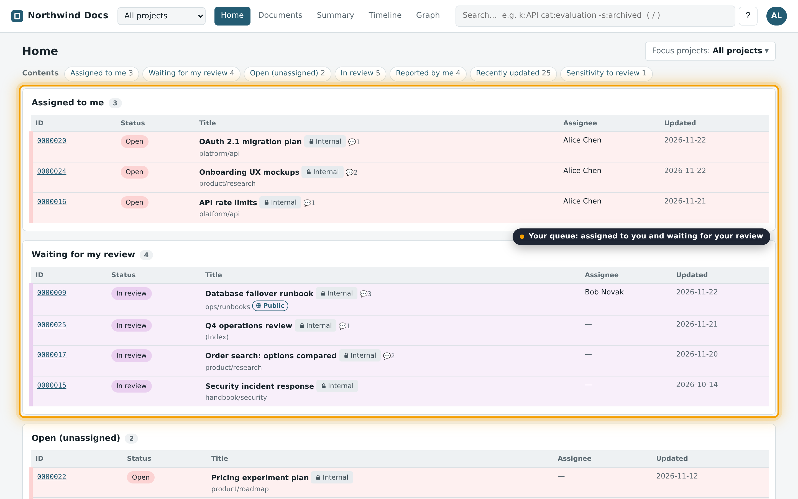
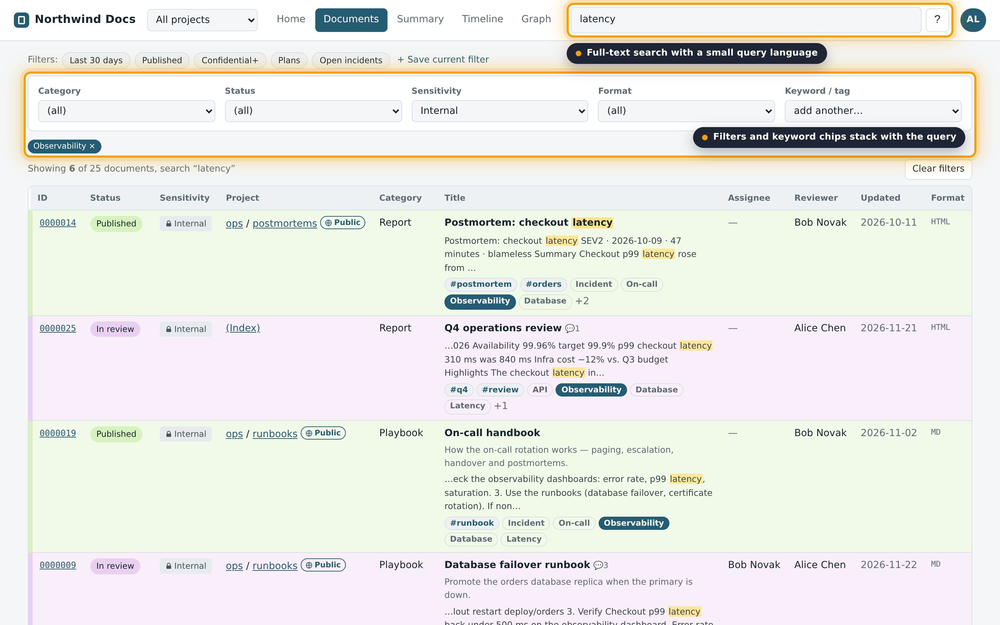
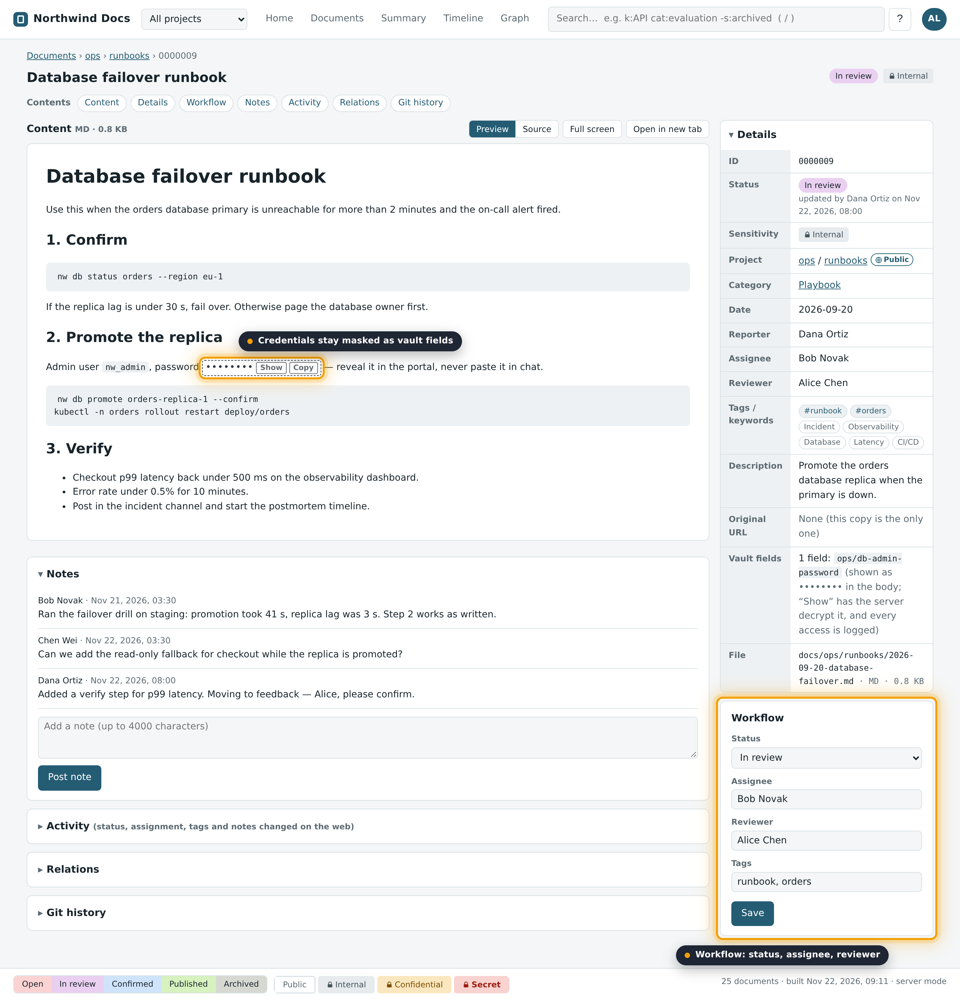
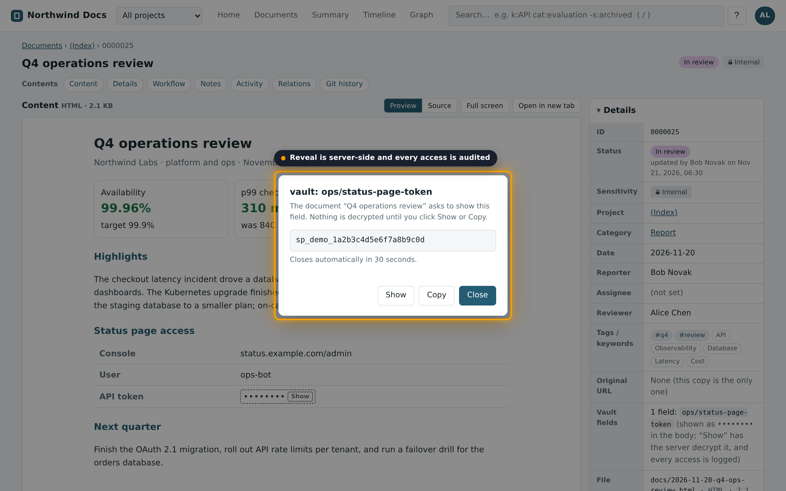
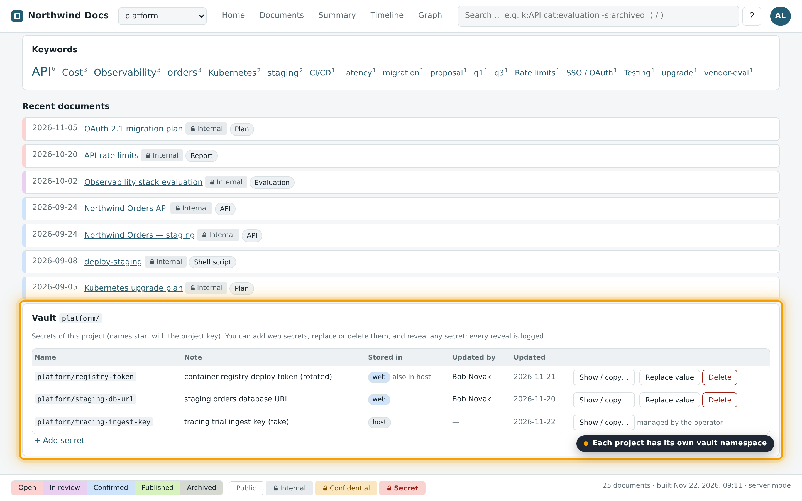
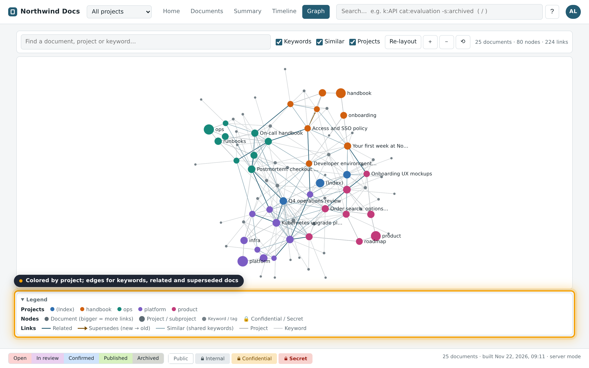
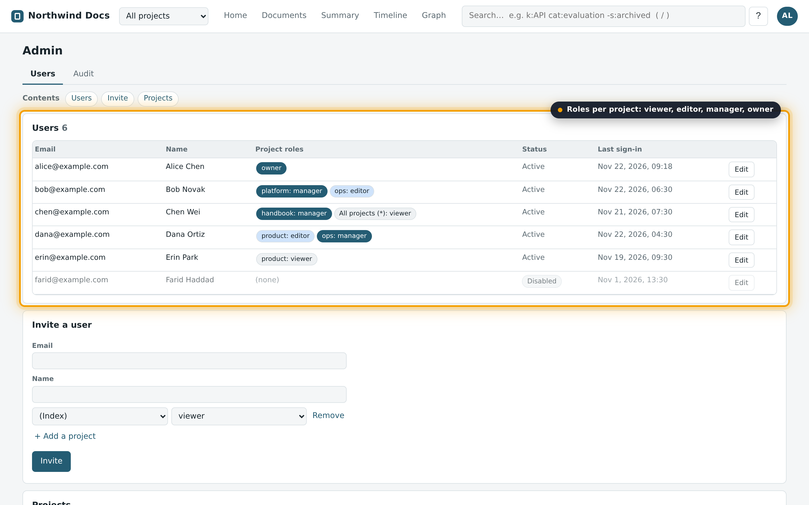
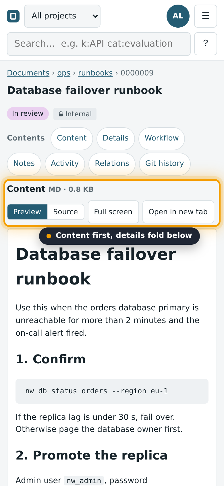

# gitdocs-portal

MantisBT 風格的文件入口，**git 就是資料庫**。把 HTML／Markdown／shell／Postman 檔案放進 `docs/`，build 一次，就有可依專案、關鍵字、機敏性分類與搜尋的入口網站，附每個檔案的 git 歷史；再加上 **vault**，讓憑證不進 git、文件本身照樣版本控管。產出是純靜態網站，參考部署是 Cloudflare Pages ＋ Cloudflare Access。

[English → README.md](README.md)

## 目錄

- [畫面截圖](#畫面截圖)
- [核心程式與內容 repo 分開](#核心程式與內容-repo-分開)
- [Vault：憑證遮罩](#vault憑證遮罩)
- [結構](#結構)
- [欄位定義](#欄位定義)
- [機敏性規則](#機敏性規則)
- [日常流程](#日常流程)
- [管理 CLI](#管理-cli)
- [搜尋語法](#搜尋語法)
- [locked：README 索引與手動修改](#lockedreadme-索引與手動修改)
- [入口畫面](#入口畫面)
- [介面語言](#介面語言)
- [Server mode（多人模式）](#server-mode多人模式)
  - [公開專案](#公開專案)
  - [機密文件](#機密文件)
- [外部內容來源](#外部內容來源)
- [貢獻](#貢獻)

## 畫面截圖

**首頁：一眼看出哪些事在等你**



**搜尋與篩選：全文檢索、查詢語法、關鍵字標籤**



**文件頁：內容優先，中繼資料與工作流程放在旁邊**



**Vault 顯示：檢查權限、由伺服器解密、每次存取都留紀錄**



**專案 Vault：管理者可新增、替換、顯示各專案的密鑰**



**關聯圖：文件、專案與共同關鍵字**



**管理：各專案角色與邀請**



**手機版：文件頁，內容優先**



全部 15 張截圖（摘要、時間軸、深色主題、個人選單、專案管理、繁體中文介面…）：[assets/screenshots/](assets/screenshots/README.zh-TW.md)。
以 `npm run screenshots` 重新產生：`examples/` 的示範內容、模擬的伺服器模式 API、以固定版本 `playwright-core` 驅動的
headless Chromium，不會啟動任何伺服器；加 `-- --plain` 產生不含標示的版本。

## 核心程式與內容 repo 分開

這個 repo 是**核心程式**（入口 UI、build、CLI），`examples/` 是示範內容。真正的文件放在另一個（通常是私有的）**內容 repo**，用 vendoring 的方式帶入核心程式：

- `npm run engine:update [ref]`：把 `scripts/engine-paths.txt` 列出的路徑從上游複製過來，並把 commit 記在 `.engine-ref`。
- `npm run engine:check`：內容 repo 裡的核心檔案只要和那個 commit 不同就失敗。放進 CI（`templates/gitlab-ci.yml`、`templates/github-actions.yml`），核心的修改就一定要先到上游發 PR。
- 內容端設定寫在 `docs/catalog.json → site`：`title`（入口名稱）、`projectRoot`（`docs/` 底下哪個資料夾的子資料夾算專案）、`readmeIndex`（提供標題／說明／網址的 Markdown 索引表）。

```bash
npm run build      # 沒有 docs/ 時 build examples/ 的示範內容
npm run dev        # http://localhost:8788，示範 vault 密語：correct horse battery staple
```

## Vault：憑證遮罩

文件常常需要把憑證寫在說明旁邊。直接 commit 不對，刪掉又讓文件不完整。vault 讓兩者並存：

```bash
npm run vault -- init                         # 只做一次；密語取自 VAULT_PASSPHRASE 或互動輸入
npm run vault -- set aws/prod/access-key      # 值從隱藏輸入或 stdin 讀，不放在指令列
# 文件裡寫：金鑰是 {{vault:aws/prod/access-key}}
npm run vault -- scan                         # 找 docs/ 裡的明文憑證
npm run vault -- scan --fix                   # 收進 vault，並把檔案改寫成 {{vault:…}}
npm run vault -- postman docs/api/prod.postman_environment.json
npm run vault -- ls | get <name> | rm <name> | mv <old> <new> | rekey | check
```

- `vault/vault.json` 只有密文，可以 commit，secret 的異動也有版本紀錄。加密方式：PBKDF2-SHA256（60 萬次）→ AES-256-GCM，以 secret 名稱當 AAD，密文搬到別的名稱底下就解不開。Node 和瀏覽器共用 `site/vault-core.js`。
- 入口的 Markdown／文字／JSON 預覽會遮罩引用：按「顯示」看 30 秒，按「複製」不顯示直接複製。解出的金鑰是不可匯出的 `CryptoKey`，只放在記憶體，重新整理或按「鎖定 vault」就失效。
- 文件一律當成不可信：`/docs/*` 帶 `Content-Security-Policy: sandbox`（opaque origin），預覽也放在 sandbox iframe，文件裡的 script 碰不到入口、金鑰或 vault。HTML 文件會內嵌一小段 shim，只負責遮罩，按「顯示」時用 `postMessage` 請入口在入口自己的對話框顯示，明文不會進到文件。
- 分享用 build（`--max-sensitivity=…`）和 `--no-vault` 不帶 vault，所有人都只看到遮罩。
- 部署出去的密文安全性完全取決於密語，請用長密語，網站本身仍要放在登入保護後面。

## 結構

```
docs/<專案>/[<子專案>/]<YYYY-MM-DD>-<slug>.html|md|sh|json   文件本體（Postman 檔也算）
docs/catalog.json                                            文件目錄（唯一手改的 metadata，可用 CLI 改）
vault/vault.json                                             加密的 secret（可 commit）
site/                                                        入口 UI（index.html、app.js、query.js、vault.js、vault-core.js、app.css）
scripts/build.mjs                                            產生 dist/（catalog、搜尋索引、檔案、vault）
scripts/doc.mjs                                              文件管理 CLI
scripts/vault.mjs                                            vault CLI
scripts/lib/catalog.mjs                                      build 與 CLI 共用的掃描／推斷邏輯
scripts/engine.sh                                            內容 repo 同步／檢查核心程式
scripts/deploy.sh                                            部署 dist/ 到 Cloudflare Pages
```

`site/query.js` 是搜尋語法的唯一實作，`site/vault-core.js` 是加解密的唯一實作，瀏覽器和 CLI 都 import 同一份。

## 欄位定義

| 欄位 | 來源 | 說明 |
|---|---|---|
| 編號 `id` | 自動 | 第一次 build 時依日期排序配發，之後不變；顯示成 `0000014` |
| 專案 `project` | 資料夾 | `docs/<projectRoot>/` 下第一層資料夾；直接放在根目錄的檔案歸在「（索引）」 |
| 子專案 `subproject` | 資料夾 | 第二層資料夾，例如 `handbook/onboarding` → 專案 handbook、子專案 onboarding |
| 分類 `category` | 推斷，可改 | 計畫／評估／比較／稽核／設計／UX／表單／技能手冊／劇本／文案／腳本／索引／報告 |
| 狀態 `status` | 推斷，可改 | 待處理／待確認／已確認／已發布／封存（Mantis 式流程）；新檔案預設「待處理」，有原始網址的標成「已發布」。舊值會自動轉換：草稿→待處理、審查中→待確認、本機→已確認 |
| 回報人 `reporter` | git，可改 | 第一次加入這個檔案的 git 作者 email |
| 處理人 `assignee` | 手動 | 要處理這份文件的人（email），`npm run doc -- assign` |
| 確認人 `reviewer` | 手動 | 要確認這份文件的人（email），`npm run doc -- review` |
| 機敏性 `sensitivity` | 推斷，可改 | 公開／內部／機密／極機密，詳見下一節 |
| 標籤 `tags` | 手動 | 自由輸入，用 `npm run doc -- tag` 管理 |
| 關鍵字 `keywords` | 自動 | 依 `catalog.json` 的 `keywords` 字典比對：標題或說明出現 1 次，或內文出現 2 次以上 |
| 相關 `related` | 手動 | 雙向顯示（A 關聯 B，B 的頁面也會顯示 A） |
| 取代 `supersedes` | 手動 | 新文件取代舊文件；舊文件頁面會顯示「已被取代」 |
| 相似文件 | 自動 | 依共同關鍵字（Jaccard）取前 5 名 |
| 歷史 | 自動 | 該檔案最近 20 筆 git commit（只放在 dist，不寫回 catalog） |
| 專案註冊表 `projects` | 自動＋手動 | 新資料夾自動加入；說明用 `npm run doc -- project` 填 |
| 儲存的篩選 `filters` | 手動 | 所有人共用的篩選，顯示在列表上方；瀏覽器另有「儲存目前篩選」存在本機 |

## 機敏性規則

| 等級 | 自動判斷條件 | build 時的效果 |
|---|---|---|
| 公開 | 不會自動判斷，只能手動設 | 同「內部」 |
| 內部 | 預設 | 正常部署、內文進全文搜尋 |
| 機密 | 個資或公司識別資料：非職務型 email（support@、affiliate@、*service@ 這類公開聯絡信箱不算）、電話、登記編號／統編＋數字、D-U-N-S 號碼、VAT 號碼、IBAN、身分證字號、街道地址 | 檔案照常部署，但**內文不進搜尋索引**（標題、說明、關鍵字仍可搜）；文件頁顯示警示，按「顯示內容」才載入預覽 |
| 極機密 | 明文憑證（收進 vault 後就不會再被判定）：`api_key=`／`secret=`／`token=`／`password=` 後面接長字串、`sk-…`、`AKIA…`、私鑰區塊、GitHub／GitLab／Slack／Google API 金鑰 | **檔案不部署**、不進搜尋索引；列表只顯示 metadata，標記「僅存 git，未上傳」 |

- build 只會**往上調**機敏性（例如之後在文件裡貼了金鑰，會自動升成極機密並印出警告），不會自動往下調。
- 用 CLI 手動設定機敏性時會標記 `sensitivityReviewed`，之後 build 就不再自動調整這份文件。
- 把憑證收進 vault（`npm run vault -- scan --fix`）後，用 `npm run doc -- set <id> sensitivity=內部` 調回來，文件就能正常部署，憑證顯示成遮罩。
- 分享用的 build：`npm run build:share`（等於 `--max-sensitivity=內部`），高於該等級的文件整份不輸出，連 metadata 都沒有。

## 日常流程

1. 把檔案放進 `docs/<專案>/`；HTML 開頭可以加一段含原始網址的註解。
2. （選用）在 `site.readmeIndex` 指定的索引表加一行（日期、標題、來源 repo、原始網址、說明）。
3. 文件裡有憑證時改寫成 `{{vault:名稱}}`，或跑 `npm run vault -- scan --fix`。
4. `npm run deploy`：build 時自動配發編號、推斷分類／狀態／機敏性、更新 `docs/catalog.json`，然後部署。
5. 需要時用 CLI 調整分類、狀態、標籤、關聯。
6. commit `docs/`、`docs/catalog.json`、`vault/vault.json` 並 push。

本機預覽：`npm run build` 之後開 `npm run dev`（http://localhost:8788）。

## 管理 CLI

```bash
npm run doc -- ls                                  # 全部
npm run doc -- ls 'k:API cat:評估 -s:已發布'     # 查詢語法同搜尋框
npm run doc -- show 14
npm run doc -- set 12 status=待確認 category=稽核
npm run doc -- assign 12 writer@example.com          # 指派處理人；- 清除
npm run doc -- review 12 lead@example.com            # 指定確認人；- 清除
npm run doc -- set 10 sensitivity=機密              # 會標記為已複核
npm run doc -- set 3 title='新標題'                  # 改 title/desc/url/date 會自動 lock
npm run doc -- tag 14 +vendor +p0 -draft
npm run doc -- relate 9 11 13                       # 9 ↔ 11、9 ↔ 13
npm run doc -- relate 9 -13                         # 移除關聯
npm run doc -- supersede 14 6 --archive             # 14 取代 6，並把 6 改成封存
npm run doc -- lock 3 / unlock 3
npm run doc -- project handbook/onboarding 'desc=新人第一週'
npm run doc -- kw ls
npm run doc -- kw add Stripe stripe '金流'
npm run doc -- kw rm Stripe
npm run doc -- filter add '本週' 'after:-7d'
```

不合法的值（例如不存在的狀態）會直接報錯，不會寫入。

## 搜尋語法

| 寫法 | 意思 |
|---|---|
| `api 成本` | 多個詞都要出現（AND），比對標題、說明、關鍵字、內文 |
| `"release notes"` | 完整片語 |
| `-封存`、`-status:封存` | 排除 |
| `p:handbook`、`p:handbook/onboarding`、`sub:onboarding` | 專案／子專案 |
| `cat:評估`、`cat:UX` | 分類（部分比對） |
| `s:已發布` | 狀態 |
| `sens:機密`、`sens>=機密`、`sens<=內部` | 機敏性，可比較等級 |
| `k:API` | 關鍵字或標籤 |
| `type:md`、`type:json` | 格式 |
| `id:14` | 編號 |
| `date:2026-11`、`date>=2026-11-01`、`date<=2026-11-30` | 日期 |
| `after:-30d`、`before:2026-11-20` | 之後／之前（含當天）；`-30d`、`-2w`、`-3m` 相對今天 |

入口的搜尋框可以和下拉選單、關鍵字篩選一起用，全部條件都要成立。搜尋框旁的 `?` 有同樣的說明。

狀態、機敏性、分類也可以用英文寫（代稱或英文標籤）：`s:open|in-review|confirmed|published|archived`、
`sens:public|internal|confidential|secret`、`sens>=confidential`、`cat:plan|evaluation|comparison|audit|design-ux|form|api|playbook|script-copy|shell-script|index|report`。
`s:published sens>=confidential` 和 `s:已發布 sens>=機密` 找到的文件完全相同。

## locked：README 索引與手動修改

- 設了 `site.readmeIndex` 時，以那份索引為準：每次 build 都會用 README 的標題、說明、原始網址、日期覆蓋 `catalog.json`。
- 用 CLI 改了其中任何一個欄位，該筆會自動加上 `"locked": true`，之後 README 就不再覆蓋它。
- 想回到以 README 為準：`npm run doc -- unlock <id>`。
- 分類、狀態、機敏性、標籤、關聯本來就不在 README 裡，不受 locked 影響，改了就一直保留。

## 入口畫面

- **專案選單**（頂列，類似 Mantis 的 All Projects）：選了之後，列表、摘要、時間軸都只顯示該專案或子專案。
- **文件列表**：常用篩選（共用＋本機）、分類／狀態／機敏／格式下拉、關鍵字多選（AND）、可排序欄位，每列依狀態上色；機敏性用鎖頭徽章表示。
- **摘要**：依分類、狀態、機敏性的數量矩陣，以及關鍵字雲、每月數量。數字點下去就是篩選好的列表。
- **時間軸**：依月份排列。
- **專案頁** `#/project/<名稱>`：專案說明、子專案、各項統計、最近文件。
- **文件頁** `#/doc/<編號>`：metadata、機敏警示、vault 欄位清單、關聯／被取代／相似文件、git 歷史、預覽（Markdown 會轉成網頁顯示，`{{vault:…}}` 顯示成遮罩）。

## 介面語言

入口介面預設是**英文**，內建**繁體中文**（zh-TW）。

- **切換**：右上角個人選單 →「語言」。畫面直接重繪，不重新載入。選擇會記住（多人模式存在 `prefs.lang`；靜態模式存在 `localStorage` 的 `gitdocs:lang`）。
- **用網址指定**：網址加 `?lang=zh-TW`（或 `?lang=en`），例如 `https://docs.example.com/?lang=zh-TW#/list`。只在使用者沒有在選單選過語言時生效，也不會被記住；適合截圖和分享連結。
- **資料不變**：狀態、機敏性、預設分類、索引專案在 `catalog.json` 和 D1 裡仍然存中文（`待處理`、`機密`、`評估`、`（索引）`…），介面只是透過對照表**顯示**成各語言（英文：Open、Confidential、Evaluation、(Index)…）。自訂的值照原樣顯示。
- **新增語言**：複製 `site/i18n/en.js` 成 `site/i18n/<語言代碼>.js`，翻譯每個值（key 和 `{參數}` 不動；複數字串是 `{ one, other }` 物件，由 `Intl.PluralRules` 挑選）。再到 `site/i18n.js` import 它、加進 `CATALOGS` 和 `LANGS`，並讓 `normLang()` 認得這個代碼；把檔案加進 `functions/_lib/gate.js` 的 `SHELL_FILES`（伺服器的允許清單；和 `site/` 不一致時測試會失敗）。儲存值的標籤是 `status.*`、`sens.*`、`cat.*`、`project.*` 這幾組 key。`site/vault-frame.js`（內嵌在沙箱 HTML 文件裡）自己帶少量字串，依文件本身的 `<html lang>` 決定語言。

## Server mode（多人模式）

靜態模式是「一群人、一個登入關卡」。Server mode 加上「人」：在 Cloudflare Access 後面用 Pages Functions（`functions/`）
＋ D1（`migrations/`），提供依專案的角色、在網頁上改狀態／指派／確認人／標籤與留言，以及由伺服器解密、只給 editor 以上、
留有稽核紀錄的 vault。完整規格見 [DESIGN.md](DESIGN.md)。沒有綁 D1 時 functions 會直接放行，同一份核心程式的靜態部署行為完全不變；但只要設了 `ACCESS_AUD`、`TEAM_DOMAIN` 或 `OWNER_EMAILS`
卻沒有 D1 綁定，所有請求都回 503，不會退回成沒有過濾的靜態站。

| | viewer | editor | manager | owner |
|---|:-:|:-:|:-:|:-:|
| 看專案文件、搜尋、留言 | ✓ | ✓ | ✓ | ✓ |
| 改狀態／處理人／確認人／標籤、顯示 vault 欄位 | | ✓ | ✓ | ✓ |
| 邀請／調整／移除專案成員 | | | ✓ | ✓ |
| 全部專案、停用使用者、稽核紀錄 | | | | ✓ |

角色以第一層專案為單位（`*`＝全部專案）。owner 由 `OWNER_EMAILS` 決定。索引專案「（索引）」的文件只有 owner，或成員資格明確寫了「（索引）」的人看得到。

### 設定步驟

1. **Cloudflare Access**：建一個 self-hosted application，涵蓋 Pages 網域和 `*.<project>.pages.dev`。記下 team domain
   （`<team>.cloudflareaccess.com`）和 application 的 **Application Audience (AUD) tag**。
2. **D1 與 migrations**（在內容 repo）：

   ```bash
   npx --yes wrangler@4.166.0 d1 create gitdocs
   cp wrangler.toml.example wrangler.toml          # 填 name、database_id、[vars]
   npx --yes wrangler@4.166.0 d1 migrations apply gitdocs --remote   # 之後可用 npm run db:migrate
   ```

3. **環境變數與 secret**（變數放 `wrangler.toml` 的 `[vars]`，secret 用 `wrangler pages secret put`）：

   | 名稱 | 種類 | 值 |
   |---|---|---|
   | `TEAM_DOMAIN` | 變數 | `example.cloudflareaccess.com` |
   | `ACCESS_AUD` | 變數 | Access application 的 AUD tag |
   | `OWNER_EMAILS` | 變數 | owner 的 email，逗號分隔 |
   | `VAULT_KEY` | secret | `node scripts/vault.mjs key \| npx --yes wrangler@4.166.0 pages secret put VAULT_KEY --project-name <project>` |
   | `ACCESS_GROUP_ID`、`CF_ACCOUNT_ID` | 變數 | 選用：讓某個 Access group 的 include 名單與啟用中的使用者同步。請用**只給這個 app 用的專屬 group**：同步會改寫整份 include 名單 |
   | `CF_API_TOKEN` | secret | 選用，group 同步用：Account → Access: Organizations, Identity Providers, and Groups → Edit |
   | `DEV_USER_EMAIL` | `.dev.vars` | 只限本機開發（只在 `localhost` 且沒有 JWT 時生效） |

   `VAULT_KEY` 是由 vault 密語導出的 AES 金鑰。Workers 跑不了 vault 的 60 萬次 PBKDF2（上限 10 萬次），所以伺服器直接拿金鑰；
   `npm run vault -- rekey` 之後要重新設定。
4. **部署**：`npm run deploy`（`wrangler.toml` 有 D1 綁定時會先套用待執行的 migrations）。部署用的 token 需要
   Account → Cloudflare Pages → Edit 和 Account → D1 → Edit。
5. 用 owner 帳號登入，打開「管理」（`#/admin`）邀請成員。有設定 group 同步時，受邀的 email 會加進 Access group；停用、刪除或失去最後一個專案成員資格時移除（再加入專案時加回）。每次變更都用 D1 算出的完整名單
   （啟用中且至少有一個專案成員資格的使用者，加上 `OWNER_EMAILS`）改寫 group 的 email 規則，同時修改也不會互相蓋掉；非 email 規則保留。
   同步失敗時 D1 的變更仍然保留，回應會帶 `warning`。
6. **本機開發**：執行 `npx --yes wrangler@4.166.0 pages dev dist --ip 127.0.0.1`（只綁 127.0.0.1，不要用 `0.0.0.0`），
   `DEV_USER_EMAIL` 放在 `.dev.vars`。

### 公開專案

類似 MantisBT 的「檢視狀態：公開」：`npm run doc -- project <名稱> visibility=public`（只限頂層專案；預設是
`visibility=private`）讓**所有已開通的使用者**都能以 viewer 身分看這個專案：文件、搜尋結果、留言（可讀也可留）。
改狀態／人員／標籤、顯示 vault 欄位、管理成員仍然需要該專案的成員資格。子專案跟著頂層專案；索引專案 `（索引）` 永遠不能公開。
`GET /api/me` 會在 `publicProjects` 列出公開專案；build 出來的 `catalog.json` 每個 `projects` 項目都帶有實際生效的 `visibility`。
static mode 不受影響。有開 Access group 同步時，只有至少有一個成員資格的使用者能通過 Access，所以另一個組織的人要給他們自己專案的成員資格（或另設 Access 規則）。

### 機密文件

server mode 下，`機密` 以上的文件只有該專案的 **editor 以上**看得到內容：viewer 與公開專案的訪客只看得到標題與欄位（`restricted: true`），
`/docs/…` 回 403。文件也可以自己宣告最低機敏性：Markdown front matter 寫 `sensitivity: 機密`，或 HTML 寫
`<meta name="sensitivity" content="機密">`（也接受 `public` / `internal` / `confidential` / `secret`）。宣告只會往上調，複核後也一樣有效；要調低就改檔案。

### 把狀態寫回 git

網頁上的修改存在 D1。`npm run state:pull`（owner 在本機執行，透過 `wrangler d1 execute --remote`）會把有變動的
狀態／處理人／確認人／標籤寫進 `docs/catalog.json`、把留言附加到 `docs/notes/<id>.md`、在 `synced` 表記下已匯出的時間，
並印出建議的 commit 訊息。`--dry-run` 只顯示變更、不寫任何東西。資料庫名稱取自 `wrangler.toml`、`$D1_DATABASE` 或 `--db=<name>`。

### 安全性說明

- 每個請求都經過 `functions/_middleware.js`：驗證 `Cf-Access-Jwt-Assertion` JWT（RS256、team 的公鑰、`aud`、`exp`、`iss`），
  而且 email 必須是 owner 或啟用中的使用者。Access 是大門，但 middleware 不盲目相信它。
- 路徑先解碼一次並正規化才套用規則（解碼後還有 `%`、`..` 或 `\` 一律拒絕）；middleware 預設拒絕：只有
  `functions/_lib/gate.js` 的 `SHELL_FILES`（有測試確保與 `site/` 一致）列出的 app shell 檔案放行，其他檔案（包括之後 build
  新增的）在列入前都是 404。
- `catalog.json`、`search-index.json`、`/docs/*` 依使用者過濾；`/docs/` 底下不在目錄裡的檔案只有 owner 看得到；`/docs/*`
  的回應一律由 middleware 加上 sandbox CSP 與 `nosniff`；`/vault.json` 永遠不提供。會修改資料的 `/api` 請求必須是
  `Content-Type: application/json`，且帶同源的 `Sec-Fetch-Site`／`Origin`（防 CSRF）。vault 的值只能透過 `POST /api/vault/reveal` 取得：檢查角色、確認該文件確實引用這個 secret、寫入 `vault_audit`，
  回應 `Cache-Control: no-store`。
- sandbox 裡的 HTML 文件只能請入口開一個遮罩中的對話框，而且只限它引用的欄位；使用者在對話框裡按「顯示」／「複製」之前，
  不會解密也不會留稽核紀錄。
- `VAULT_KEY` 能解開 git 裡 `vault/vault.json` 的所有 secret，請和密語同等保管。
- 分享用 build（`--max-sensitivity`）也會拿掉回報人／處理人／確認人的 email。`docs/notes/` 永遠不部署。

## 外部內容來源

第二個組織可以從**他們自己的 git repo** 把文件放進同一個入口（他們只推自己的 repo，碰不到你的內容 repo），在入口裡成為一個頂層專案。
在 `docs/catalog.json` 宣告來源：

```json
"site": { "sources": [{ "name": "acme", "repo": "https://git.example.com/acme/docs.git", "ref": "main", "path": "docs" }] }
```

```bash
npm run sources:pull     # 把每個來源抓到 .sources/<名稱>/（已列入 gitignore；內容 repo 也要在 .gitignore 加 ".sources/"）
npm run build            # .sources/acme/docs/** 會掛在 docs/acme/** — 編號與欄位仍存在你的 catalog.json
```

- `name` 是專案代號（`[a-z0-9-]`，不能和本地資料夾同名）；`path` 是來源 repo 裡的資料夾（預設是 repo 根目錄）；`ref` 是分支／tag／commit。
  子資料夾變成子專案；git 歷史與建立者取自來源 repo；紀錄會帶 `source: "acme"`。
- **憑證**不要寫進 `catalog.json`：用 git 的 credential helper／SSH agent，或在 CI 設遮罩變數 `SOURCE_ACME_URL`
  （例如在網址的 userinfo 帶唯讀的 GitLab deploy token：`https://deploy:<token>@…`）覆蓋 `repo`。這個網址不會寫進 `.sources/`，錯誤訊息裡也會遮掉；
  帶 query string 或 fragment 的網址（`?private_token=…`）會被拒絕。
- **來源 repo 能做與不能做的事**：只能決定檔案內容。symlink 與點開頭的檔案會跳過、掛載點跳不出自己的資料夾；欄位、公開設定、成員資格都在你的 repo 與 D1；
  它的文件只能用 `acme/` 底下的 vault 名稱（secret 由你封存在你的 vault）：其他 `{{vault:…}}` 引用會被 build 擋掉，`/api/vault/reveal` 也會拒絕。
  機敏性規則照樣適用（`極機密` 不上傳）；`npm run vault -- check`／`scan` 對掛載檔案只發警告，也絕不修改它們。
- **沒有 checkout**（沒有憑證、抓取失敗）：build 會警告並且不部署這個來源的文件，但保留 catalog 裡的項目（編號、流程狀態），
  直到成功抓取後確認檔案真的不在了才刪。`sources:pull` 失敗時會以 1 結束，CI 不會部署缺了來源的網站。
- **它自己的 secret**（三個地方，依序查找，細節見 [DESIGN.md](DESIGN.md#tenant-vaults)）：
  1. *網頁 vault*：`acme` 專案的 manager 在入口網站新增／更換／刪除 `acme/…` 的 secret（用 `VAULT_KEY` 加密存在 D1，有版本歷史；值不會出現在 log 或歷史裡）。
  2. *來源 repo 自己的 vault*：租戶 clone gitdocs-portal 後執行 `CONTENT_DIR=../acme-docs node scripts/vault.mjs init` 與
     `… set acme/smtp/password`，commit `acme-docs/vault/vault.json`（用他們自己的密語），再把 `node scripts/vault.mjs key`
     的輸出透過安全管道交給你一次；你用 `npx --yes wrangler@4.166.0 pages secret put VAULT_KEY_ACME --project-name <project>` 存起來。
     伺服器模式的 build（`wrangler.toml` 有 D1 binding，或加 `--server`）會把這個檔案（只留 `acme/…` 的名稱）部署到永遠不對外提供的位置；靜態 build 不會帶它。
     網頁 vault 的 manager 不能覆蓋放在這裡或 host vault 的 secret（409）；owner 可以，而且會留下紀錄。
  3. *你的 host vault*：你自己封存在 `acme/…` 底下的 secret。
- **來源更新就重新部署**：CI 範本會先抓來源再 build；`templates/gitlab-ci.yml` 有來源 repo 要呼叫的 pipeline trigger 範例，
  讓它們 push 後入口自動重新部署（GitHub 用 `repository_dispatch`）。細節見 [DESIGN.md](DESIGN.md#external-content-sources)。

## 貢獻

歡迎 issue 和 PR：UI、搜尋語法、偵測規則、vault、文件、翻譯都可以。請維持零相依套件，送出前確認 `npm test`、示範內容的 `npm run build` 和 `node scripts/vault.mjs check` 都通過，範例裡不要放真實文件或憑證。授權：MIT。
