# Screenshots

**English** · [繁體中文](README.zh-TW.md)

Generated by `npm run screenshots` (tools/screenshots/capture.mjs) from the demo
content in `examples/` with a mocked server-mode API. Do not edit by hand.

**Home — what needs you, at a glance**

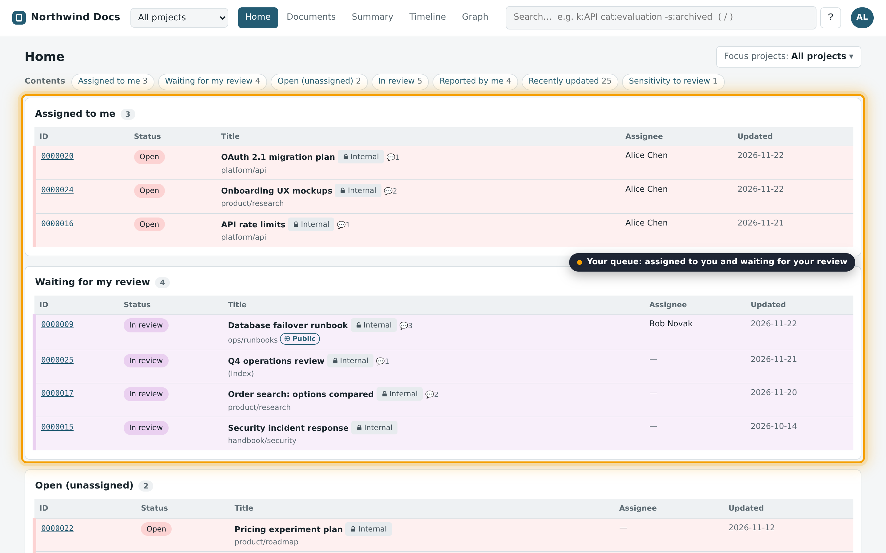

**Search and filter — full text, query language, keyword chips**

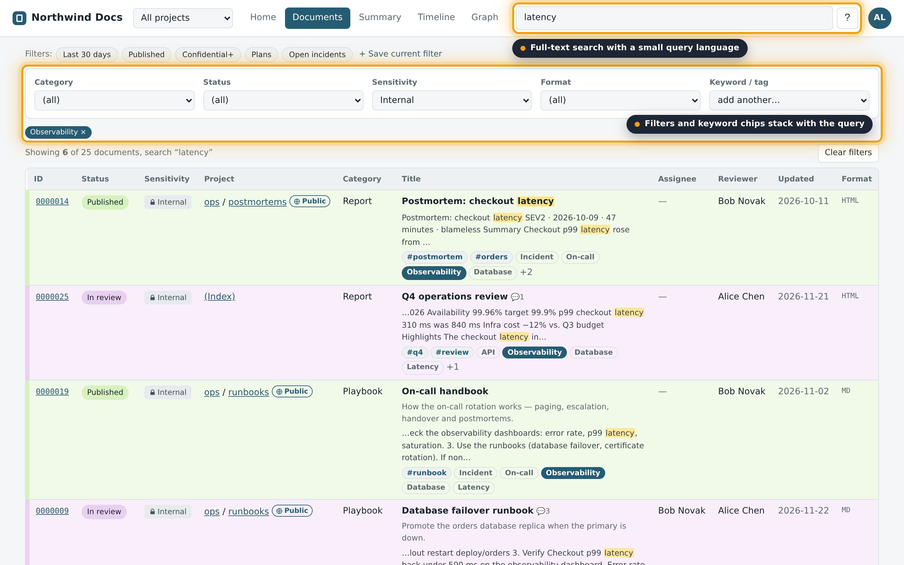

**Document page — the content first, metadata and workflow beside it**

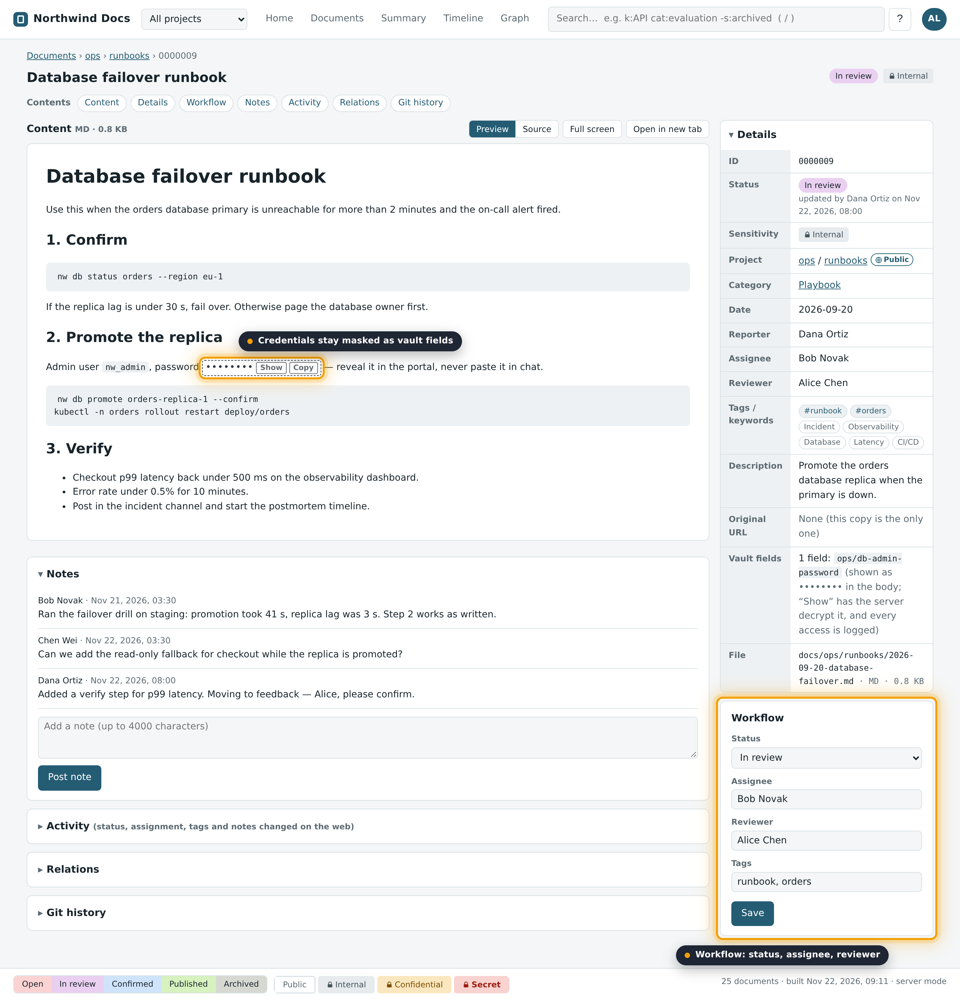

**Vault reveal — role-checked, decrypted by the server, audited**

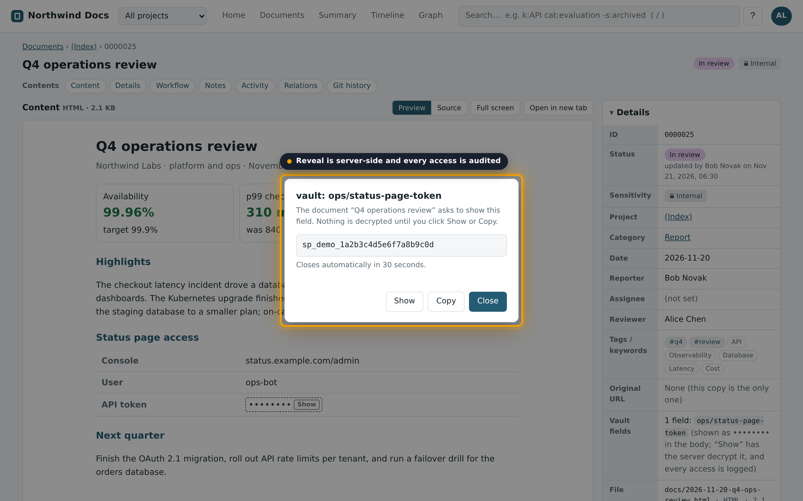

**Project vault — managers add, replace and reveal secrets per project**

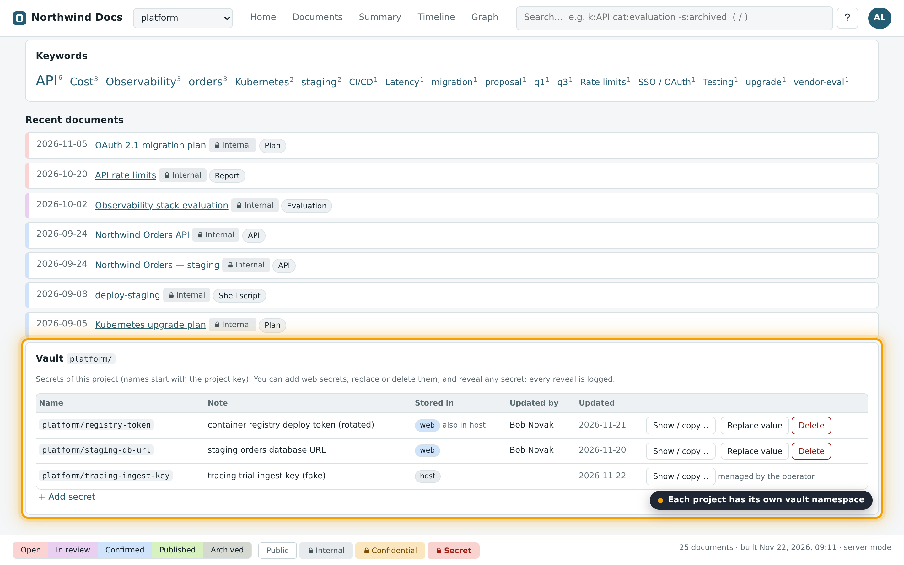

**Summary — matrices by category, status and sensitivity**

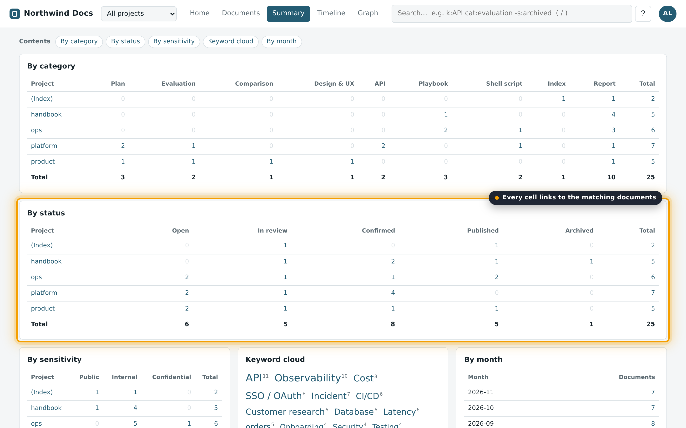

**Timeline — newest first, colored by workflow status**

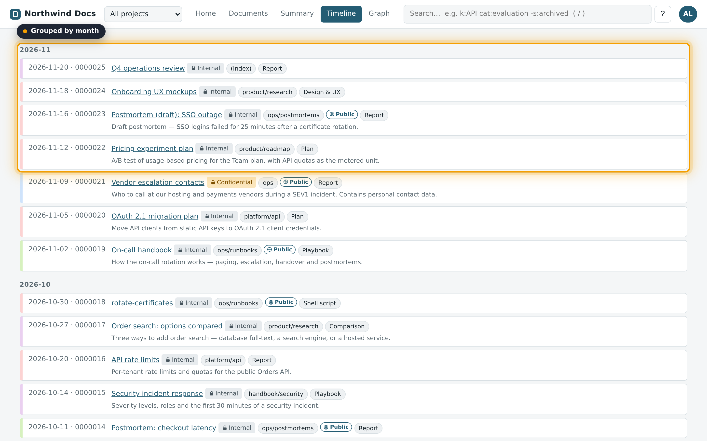

**Knowledge graph — documents, projects and shared keywords**

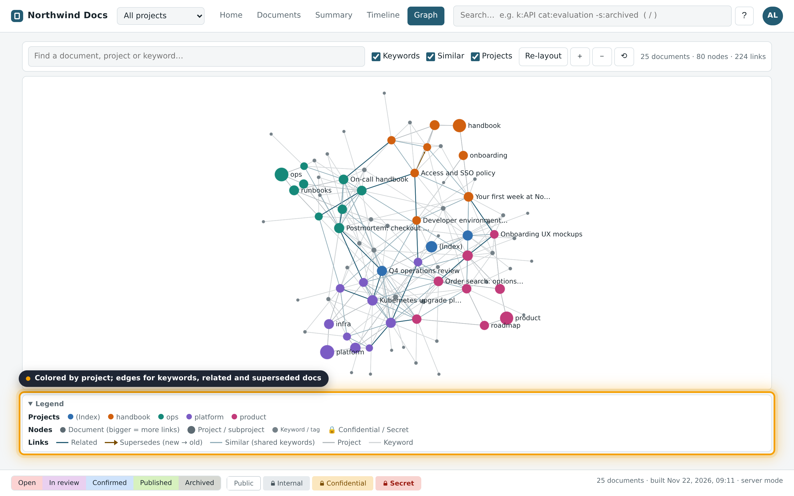

**Admin: users — per-project roles, invitations, last seen**

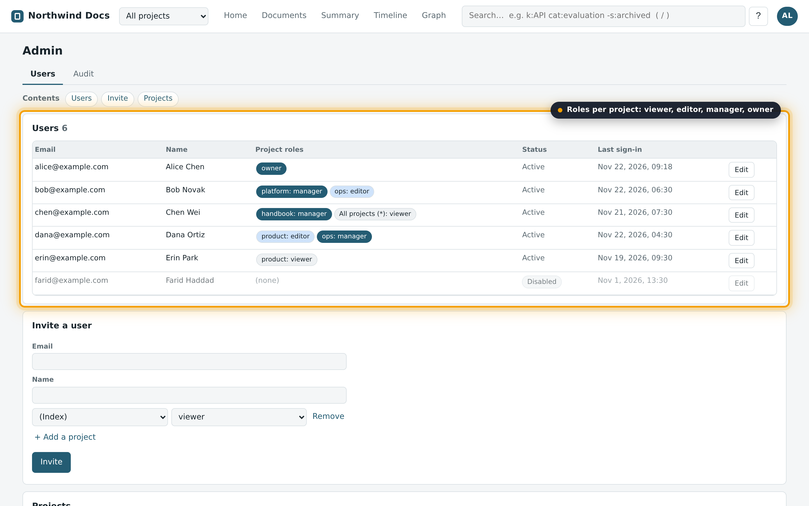

**Admin: projects — visibility and a link to each project vault**

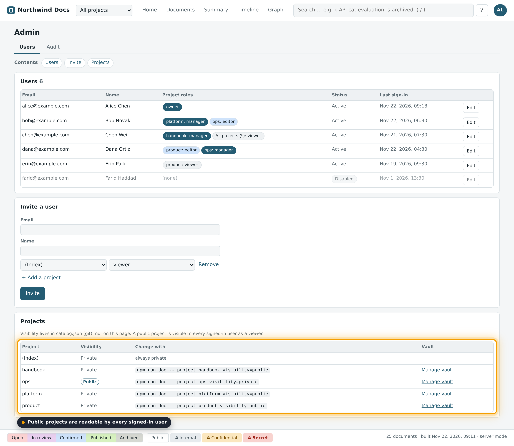

**Profile menu — display name, language and theme**

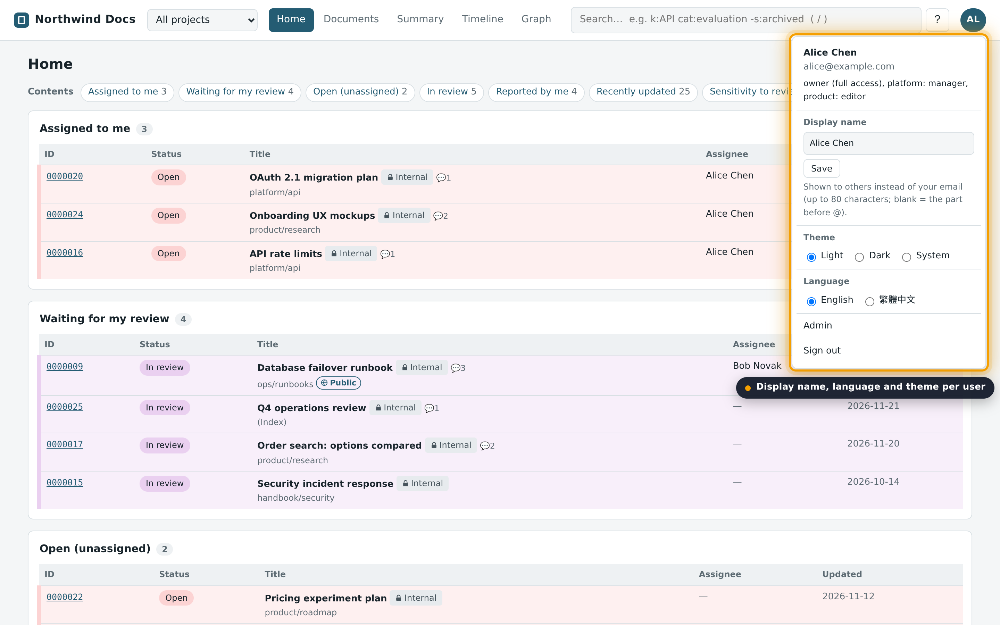

**Dark theme**

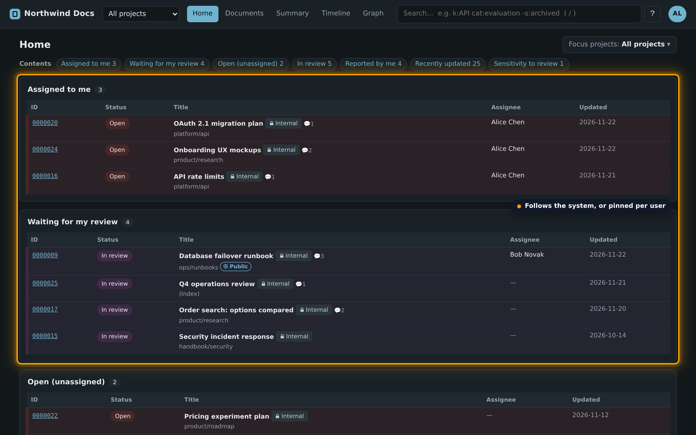

**Mobile — home page**

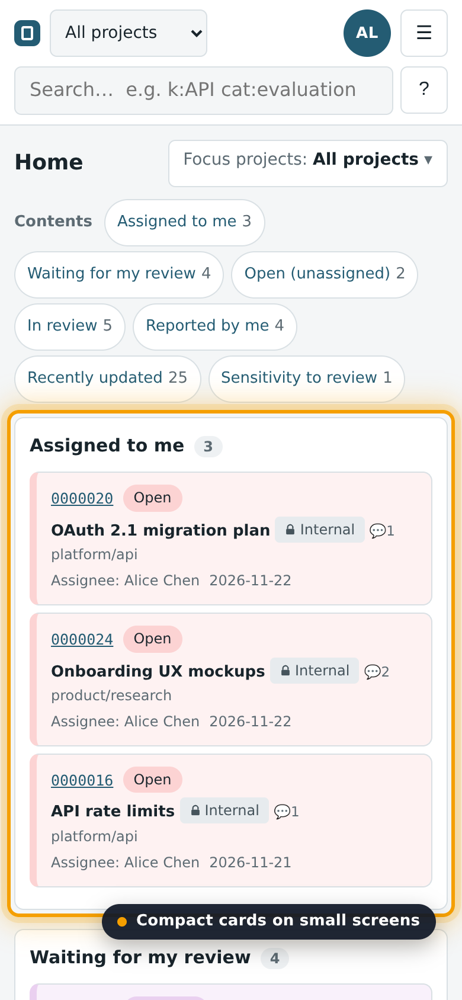

**Mobile — document page, content first**

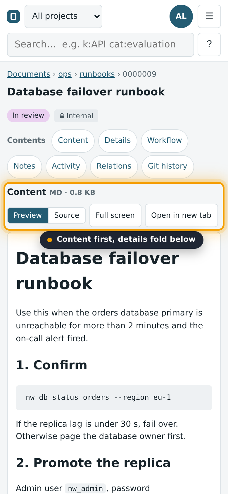

**Traditional Chinese (zh-TW)**

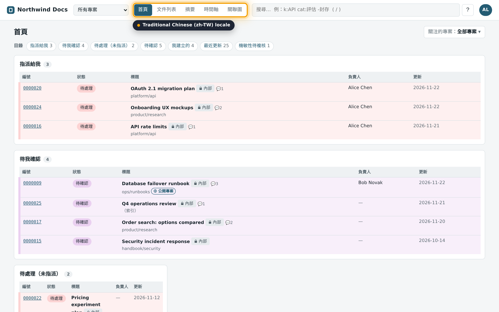
