# 畫面截圖

由 `npm run screenshots`（tools/screenshots/capture.mjs）以 `examples/` 的示範內容和模擬的
伺服器模式 API 產生，請勿手動修改。[English](README.md)

**首頁：一眼看出哪些事在等你**

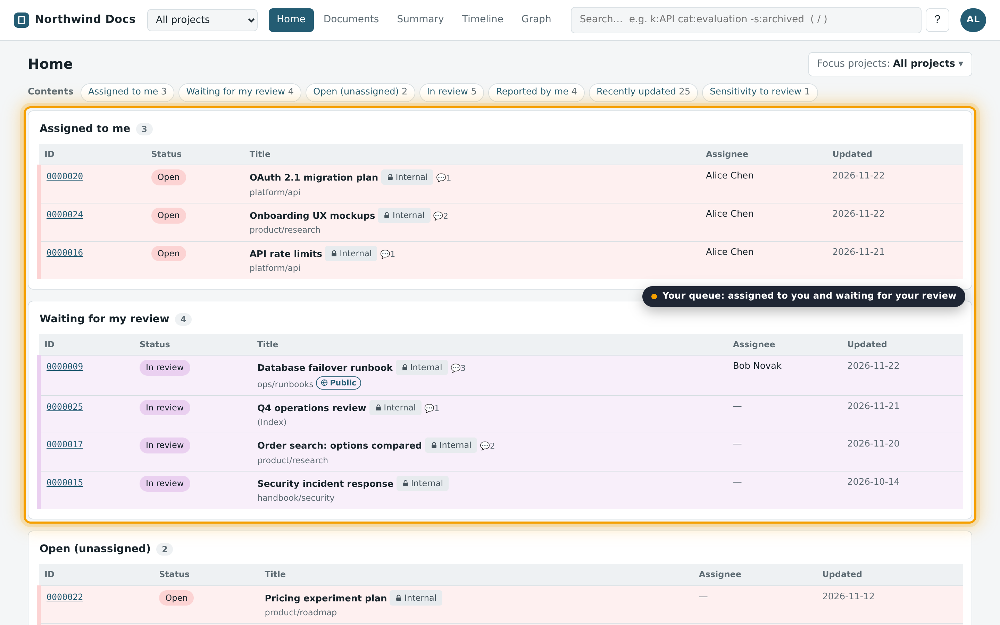

**搜尋與篩選：全文檢索、查詢語法、關鍵字標籤**

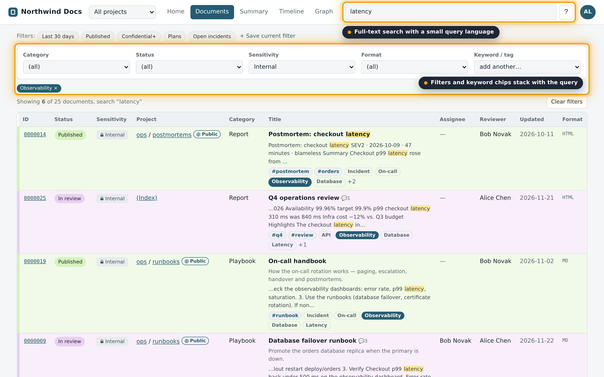

**文件頁：內容優先，中繼資料與工作流程放在旁邊**

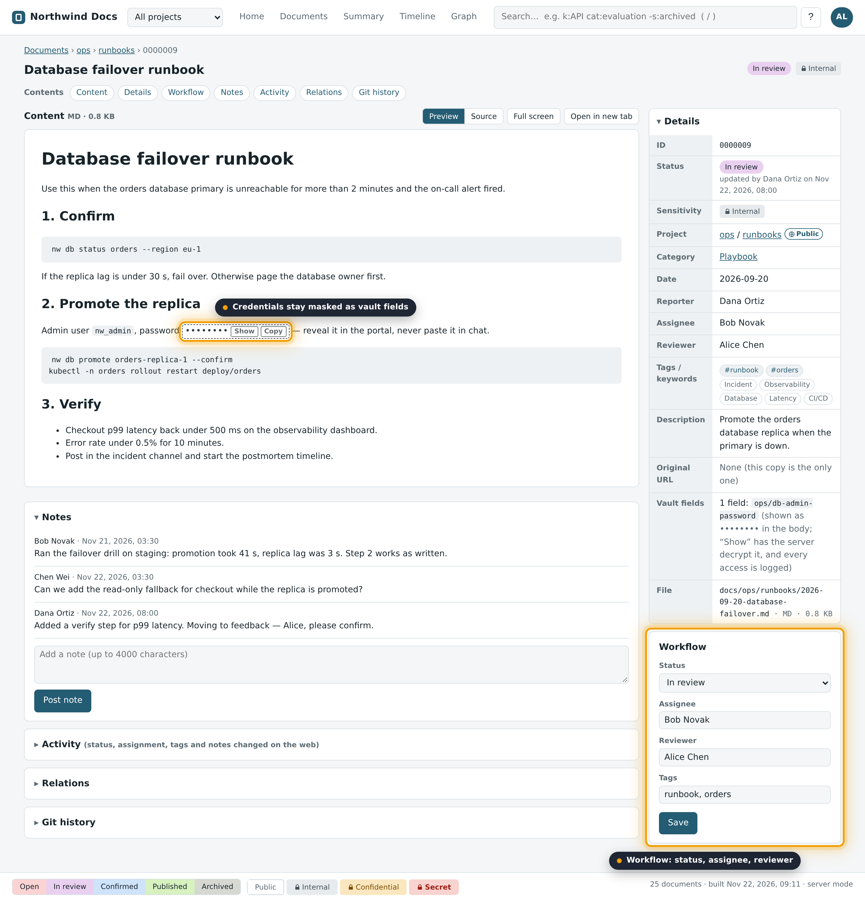

**Vault 顯示：檢查權限、由伺服器解密、每次存取都留紀錄**

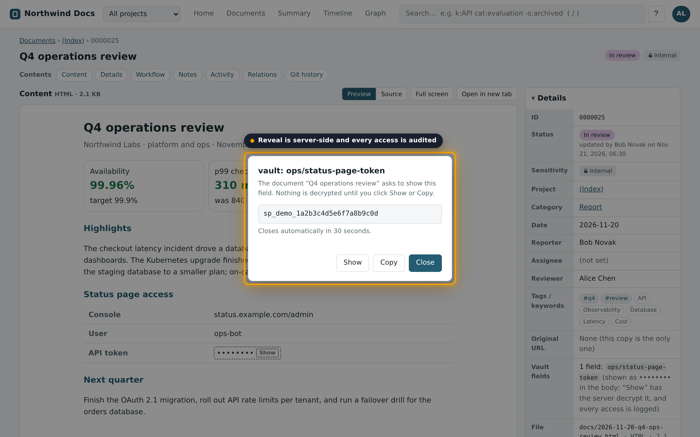

**專案 Vault：管理者可新增、替換、顯示各專案的密鑰**

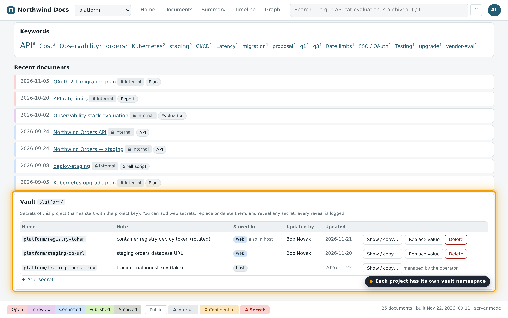

**摘要：依分類、狀態、機敏性的統計矩陣**

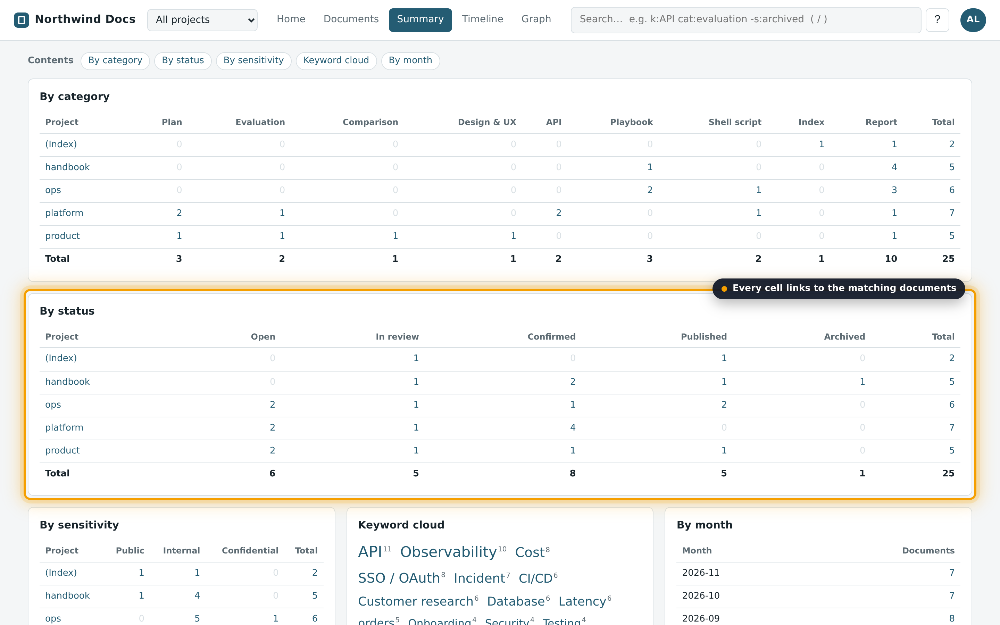

**時間軸：由新到舊，依工作流程狀態著色**

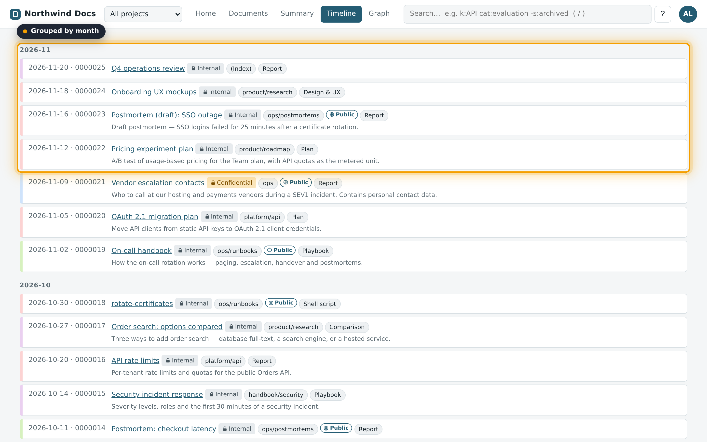

**關聯圖：文件、專案與共同關鍵字**

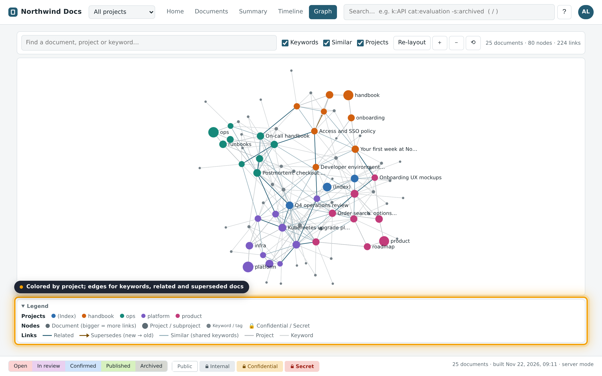

**管理：使用者（各專案角色、邀請、最近登入）**

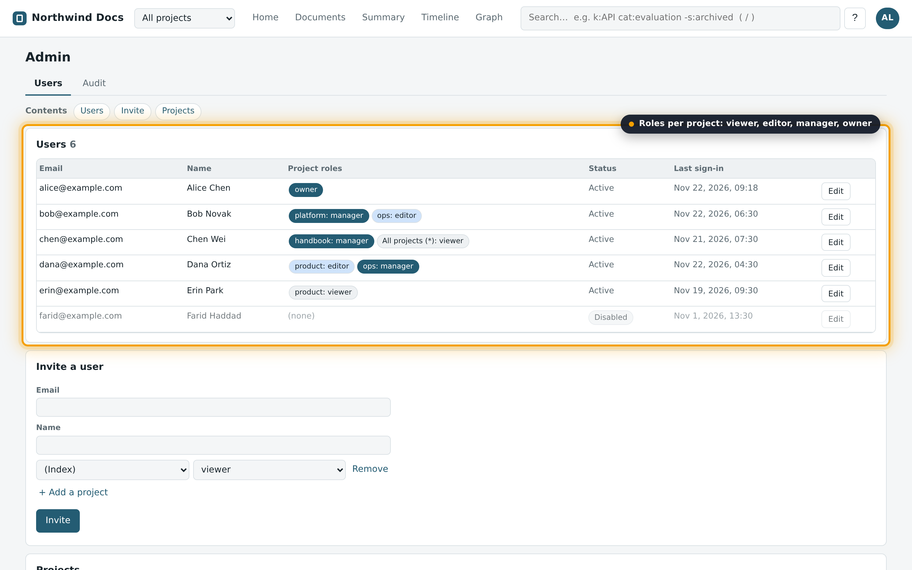

**管理：專案（公開設定與各專案 Vault 入口）**

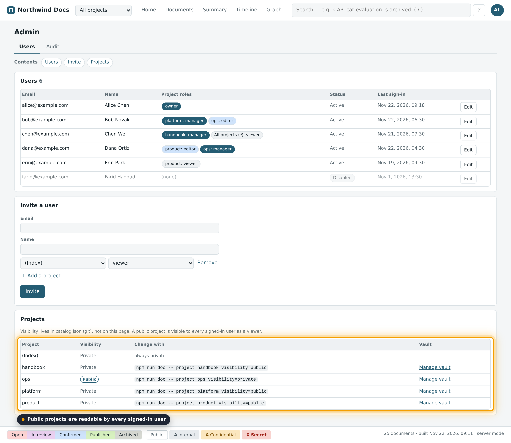

**個人選單：顯示名稱、語言、佈景主題**

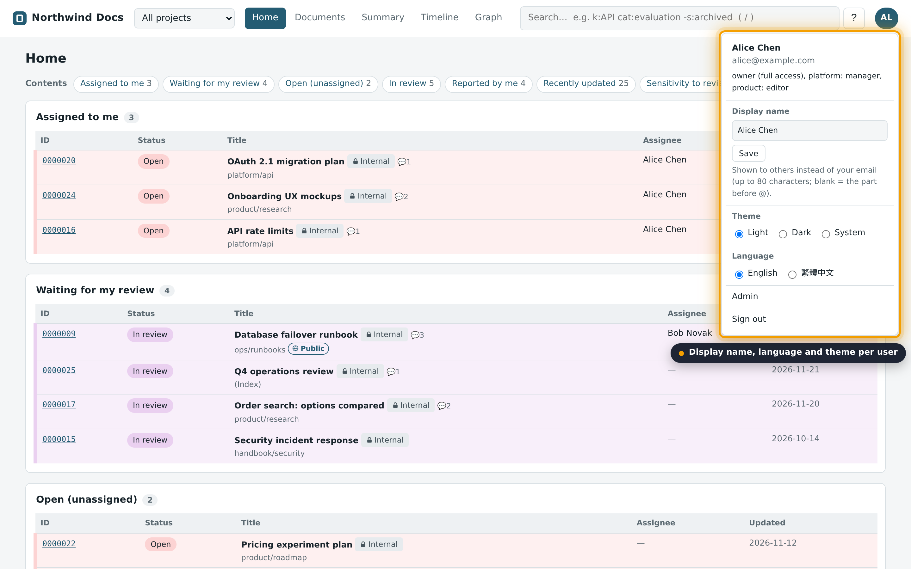

**深色主題**

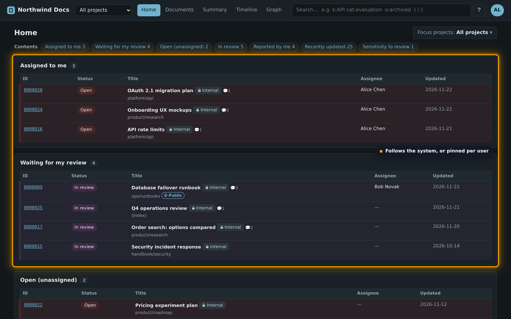

**手機版：首頁**

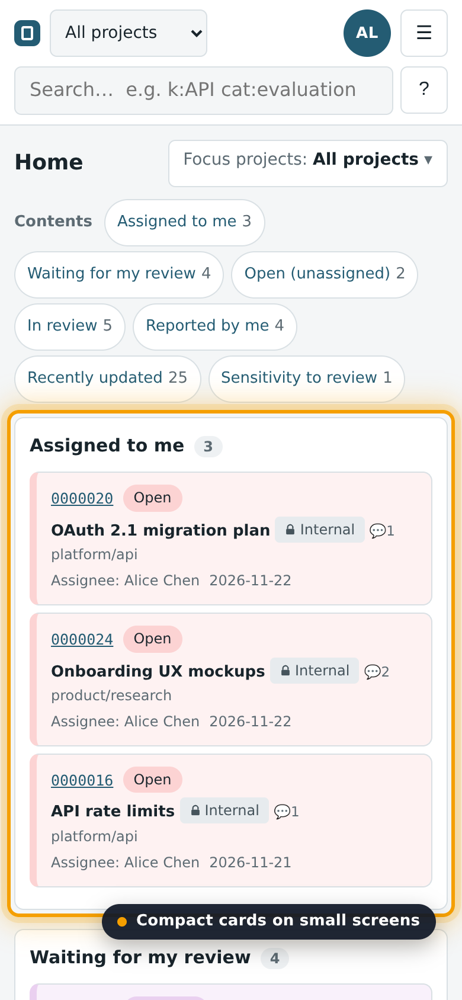

**手機版：文件頁，內容優先**

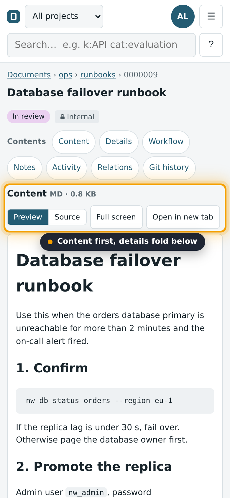

**繁體中文介面（zh-TW）**

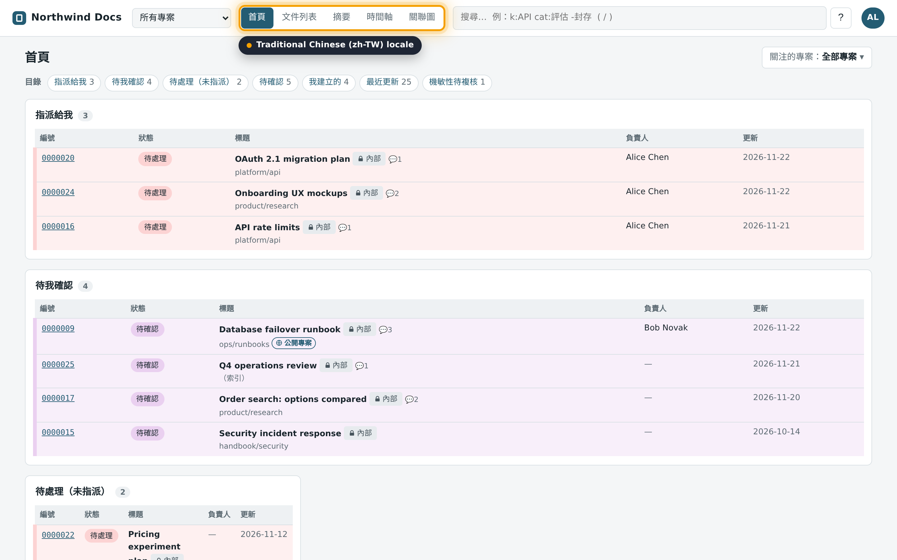
